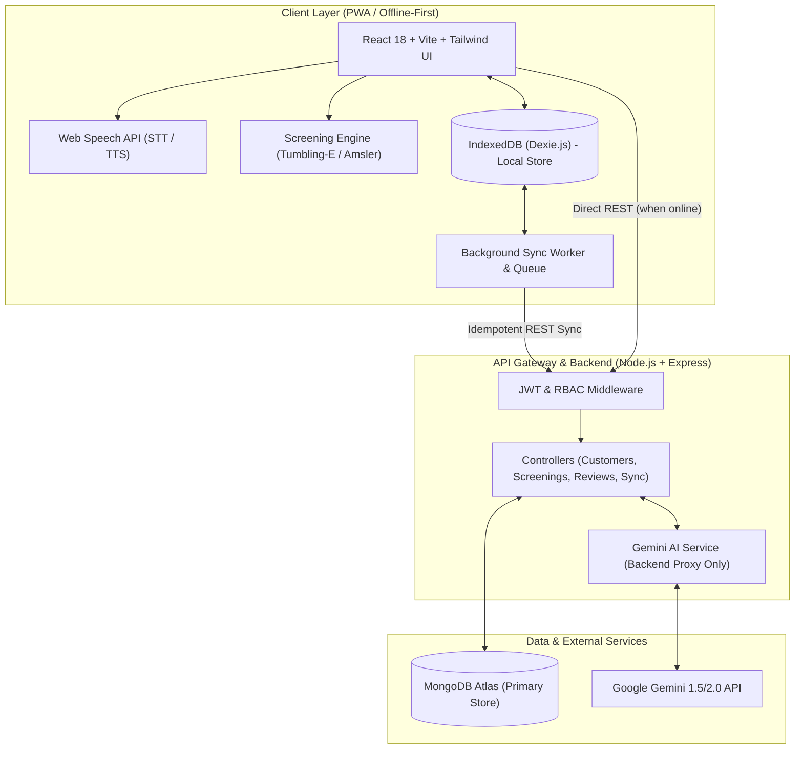
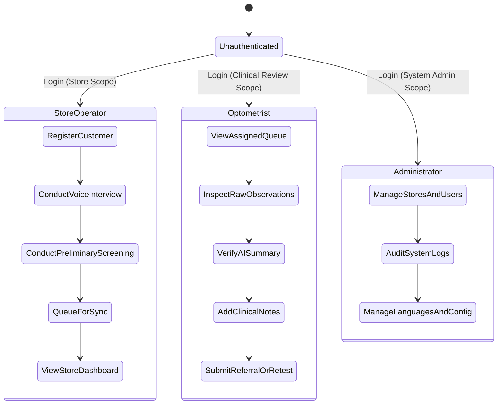
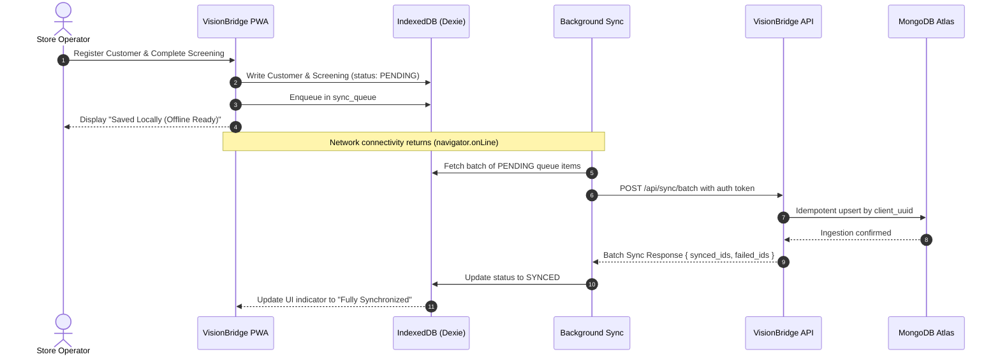
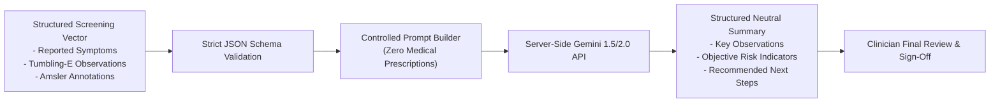

# VisionBridge System Architecture & Technical Specification

> **Product**: VisionBridge  
> **Tagline**: *Speak. We listen. An eye-care professional reviews.*  
> **Classification**: AI-Assisted, Voice-First, Offline-Capable Preliminary Vision Screening & Optometrist-Connect Platform  
> **Document Version**: 1.0.0 (Production Foundation)

---

## 1. Executive Summary & Core Philosophy

VisionBridge addresses the severe lack of accessible eye-care infrastructure in rural communities, peri-urban local optical stores, and underserved regions. Rather than attempting to automate clinical diagnosis or replace licensed optometrists, VisionBridge functions as a **triage, structured preliminary screening, and professional-connect bridge**:

$$\text{Customer Registration} \longrightarrow \text{Voice Interview} \longrightarrow \text{Preliminary Screening} \longrightarrow \text{AI-Assisted Profile} \longrightarrow \text{Professional Review} \longrightarrow \text{Guidance \& Referral}$$

### Fundamental Non-Negotiable Medical Guardrails
1. **No Refraction / Power Calculation**: The system never claims to measure refractive error or prescribe lens diopters.
2. **No Clinical Diagnosis**: The platform never diagnoses cataracts, glaucoma, macular degeneration, diabetic retinopathy, or any ocular disease.
3. **Strict Emergency Interception**: Predefined high-risk symptoms (e.g., sudden vision loss, acute eye pain, flashes of light, severe ocular trauma) immediately halt routine screening and trigger urgent emergency care protocols.
4. **Transparent Tri-Partite Profiling**: Every generated document strictly and visibly demarcates:
   - *Customer-Reported Information* (Subjective voice/survey answers)
   - *Application-Generated Observations* (Tumbling-E responses, Amsler grid annotations, test quality indicators)
   - *Professional Review & Recommendations* (Certified optometrist notes, referral decisions, retest requests)
5. **Human-in-the-Loop Review**: AI (Google Gemini) provides structured neutral summaries and multilingual rephrasing, but never clinical conclusions. All cases are queued for licensed eye-care professional sign-off.

---

## 2. System Topology & Architecture

---

## 3. Technology Stack & Design Decisions

| Layer | Technology | Justification |
| :--- | :--- | :--- |
| **Frontend Framework** | React 18 + TypeScript + Vite | Blazing fast build, lightweight bundle, strict type safety for medical-grade form/test data. |
| **Styling & Design System** | Tailwind CSS + Lucide React | High-contrast healthcare palette (Deep Navy `#0A2540`, Teal `#0D9488`, Slate `#F8FAFC`). Crisp accessibility. |
| **State & Data Fetching** | TanStack Query v5 + React Hook Form + Zod | Cache management, optimistic UI updates, strict schema validation at the UI boundary. |
| **Local Offline Storage** | IndexedDB + Dexie.js | Full offline storage for customer demographics, voice interview transcripts, and screening test vectors. |
| **PWA & Offline Shell** | Service Worker + Web App Manifest | Instant load even in deep offline rural environments with intermittent 2G/3G connectivity. |
| **Voice & Speech Engine** | Browser SpeechRecognition & SpeechSynthesis | Zero-bandwidth client-side speech input/output where supported, graceful fallback to typed and button choices. |
| **Backend Framework** | Node.js + Express + TypeScript | Lightweight, high-throughput REST architecture with end-to-end typed contract with frontend. |
| **Primary Database** | MongoDB Atlas via Mongoose | Flexible document model supporting diverse multilingual interview responses, screening vectors, and audit trails. |
| **AI Integration** | Google Gemini API (Backend only) | Multilingual normalization and structured clinical summaries without frontend key exposure. |

---

## 4. Role-Based Access Control (RBAC)

The platform supports 3 primary operational roles:

### Granular Permission Matrix

| Resource / Capability | Store Operator | Optometrist / Reviewer | Administrator |
| :--- | :---: | :---: | :---: |
| Register customer & store offline | Yes | Read-only | Full |
| Conduct interview & screening | Yes | Read-only | No |
| View customer raw responses | Yes (Own Store) | Yes (All Assigned) | Full |
| Read AI-generated summary | Yes | Yes | Full |
| Add optometrist notes & referral | No | Yes | Audit-only |
| Request customer retest | No | Yes | No |
| Sync offline queue | Yes | No | No |
| Manage users & store credentials | No | No | Yes |

---

## 5. Offline-First Synchronization Architecture

In rural field operations, reliable 4G/5G connectivity cannot be guaranteed. VisionBridge employs a **local-first, write-immediate, sync-eventual** architecture:

1. **Local Writes**: Every registration, voice interview response, and screening observation is immediately committed to IndexedDB via Dexie.js.
2. **Deterministic ID Generation**: Customer records and test sessions use UUIDv4 / CUID identifiers generated client-side, avoiding ID collisions upon server ingestion.
3. **Queue Ingestion**: Records are placed into an IndexedDB `sync_queue` marked with status `PENDING`, `SYNCING`, `SYNCED`, or `FAILED`.
4. **Idempotent Ingestion Endpoint**: The backend `/api/sync/batch` endpoint processes batches transactionally using upsert operations based on client UUID and record timestamp.
5. **Conflict Resolution**: Client record version numbers and timestamps ensure that later offline edits do not overwrite newer professional reviews from the optometrist portal.

---

## 6. Screening Methodologies & Mathematical Principles

### A. Visual Acuity (Tumbling-E Optotype)
- **Principle**: The user identifies the orientation (Up, Down, Left, Right) of the letter "E". Does not require literacy or knowledge of the Latin alphabet.
- **Viewing Distance & Calibration**: Calibrated to standard smartphone viewing distance (40 cm for near screening, or 1-2 meters for guided distance check).
- **LogMAR / Snellen Scaling**: Optotype height $h$ subtends an angle $\theta$ (5 arcminutes for 20/20 standard) calculated as:
  $$h = 2 \times d \times \tan\left(\frac{\theta}{2}\right)$$
- **Preliminary Observation**: Recorded as discrete fractional values (e.g., 6/60, 6/36, 6/24, 6/18, 6/12, 6/9, 6/6) strictly tagged as *Preliminary Screening Score* subject to clinical verification.

### B. Amsler Grid Observation
- Evaluates central $10^\circ$ of visual field for macular distortion.
- Patient fixates on central dot and reports:
  - Missing lines (scotoma)
  - Wavy or distorted grid lines (metamorphopsia)
  - Blurry or dark patches
- Any affirmative distortion immediately flags the record with high priority for professional review.

---

## 7. AI Module Architecture & Safety Boundaries

- **Fail-Safe Fallback**: If Gemini API is unreachable, rate-limited, or disabled, the application automatically builds a deterministic rule-based summary using TypeScript formatting templates. The platform functions 100% reliably without AI.

