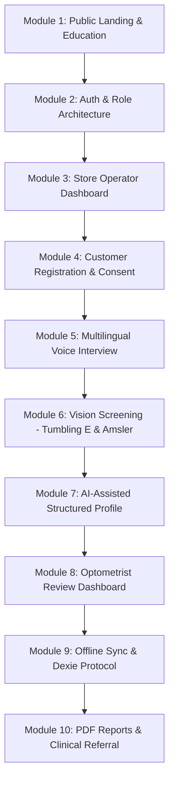

# VisionBridge Modular Development Plan & Implementation Roadmap

## Overview
VisionBridge is engineered as a robust, production-grade healthcare technology platform. Development is partitioned into 10 structured, independently verifiable modules adhering to medical safety boundaries, offline resilience, and human-in-the-loop review.

---

## Phased Module Roadmap

### Module Breakdown & Acceptance Criteria

| Module | Core Deliverable | Safety / Architectural Guardrail | Verification Strategy |
| :--- | :--- | :--- | :--- |
| **M1: Landing Page** | Public portal, product value, process walkthrough, clinical disclaimers. | Non-diagnostic disclaimer must be prominent and persistent. | Responsive layout, visual contrast, clarity of messaging. |
| **M2: Auth & RBAC** | JWT authentication, role guards (`STORE_OPERATOR`, `OPTOMETRIST`, `ADMIN`). | Sensitive endpoints reject unauthorized tokens. Password hashing via bcrypt. | Protected route redirects, invalid token rejection tests. |
| **M3: Store Dashboard** | Operational overview, sync queue status, recent activity, quick actions. | Clear visual distinction between synced vs offline data. | Metric calculation with realistic simulated data. |
| **M4: Customer Reg** | Client-side UUID generation, minimal PII, bilingual consent recording. | Explicit consent check required before proceeding. | Validation with Zod schema, offline storage in Dexie. |
| **M5: Voice Interview** | Web Speech STT/TTS, Hindi/English, adaptive question branch engine. | Hardcoded red flag triggers (acute pain, sudden loss) abort routine flow. | STT error handling, manual fallback selection, question branching. |
| **M6: Vision Screening** | Tumbling-E optotype visual acuity, Amsler grid distortion detection. | Results labeled strictly as preliminary observation; no power diopter calculation. | Device calibration logic, score progression algorithm. |
| **M7: AI Vision Profile** | Gemini proxy, structured JSON schema summary with deterministic fallback. | Zero hallucinated medical diagnosis; neutral clinical summarization only. | Schema validation test, offline/offline fallback generator test. |
| **M8: Review Dashboard** | Case queue for optometrists, raw test inspector, referral notes. | Reviewer must be able to view raw inputs, not only AI summary. | Optometrist sign-off flow, referral priority flagging. |
| **M9: Offline Engine** | IndexedDB Dexie tables, background sync queue, conflict resolution. | Idempotent upserts to prevent duplicate customer records. | Network disconnect/reconnect simulation test. |
| **M10: Reports & Export** | High-fidelity clinical PDF export, referral document generation. | Prominent medical limitation disclaimer on all exported documents. | PDF rendering fidelity, print-ready CSS formatting. |

---

## Current Step: Foundation & Initial UI
- Task A: Requirements & Risk Analysis (Completed)
- Task B: Architecture & API Specs (Completed in `docs/`)
- Task C: Monorepo Setup (Frontend Vite + Tailwind, Backend Express + TypeScript, Shared Types, DB Config, PWA foundation)
- Task D: Initial UI (Landing Page, Store Dashboard, Optometrist Dashboard with clear demo markers)
- Task E: Verification (Type checking, build checks, API health check)

