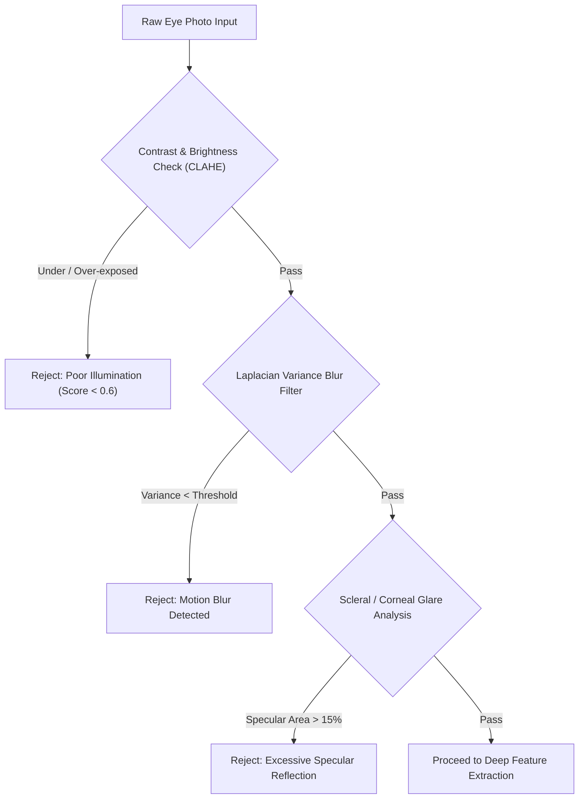

# VisionBridge — Future AI Image Analysis Architecture
## Multi-Modal Ophthalmic Triage & Computer Vision Pipeline

**Document Status:** Architecture Blueprint & Roadmap Specification  
**Version:** 1.0.0 (Milestone 4.1)  
**Authors:** VisionBridge Core Engineering & Clinical Architecture Team  
**Review Standards:** HIPAA, GDPR Article 9, CE/FDA SaMD Good Machine Learning Practice (GMLP)

---

## 1. Executive Summary & Design Principles

VisionBridge currently utilizes an optometrist-in-the-loop tele-optometry model. In accordance with clinical safety principles, **Milestone 4.1 deliberately operates without automated diagnostic predictions or fabricated confidence scores**.

This document outlines the architectural roadmap for integrating an automated computer vision triage pipeline in future milestones without introducing brittle dependencies or compromising patient privacy.

### Core Architectural Principles
1. **Safety First (Zero Hallucinated Diagnoses):** AI outputs serve strictly as pre-screening triage flags (e.g., image quality failure, urgent referral triage) and never formulate autonomous medical diagnoses.
2. **Multi-Modal Separation:** Anterior segment photos (macro smartphone/slit-lamp) and posterior segment (fundus) images follow segregated machine learning pipelines with specialized neural architectures.
3. **Privacy by Design:** All personally identifiable information (PII) is stripped prior to any neural network inference.
4. **Loosely Coupled Microservices:** The AI inference engine will run as an independent Python/FastAPI service communicating via authenticated asynchronous gRPC / REST contracts, preserving the core Node.js application's stability.

---

## 2. Multi-Modal Pipeline Architecture

```
                                  [ Consumer Smartphone / Mobile Lens Adapter ]
                                                        │
                                                        ▼
                                       [ VisionBridge Node.js Core Backend ]
                                       (Storage, Auth, Consent Verification)
                                                        │
                              ┌─────────────────────────┴─────────────────────────┐
                              ▼                                                   ▼
               [ Anterior Segment Pipeline ]                             [ Fundus / Posterior Pipeline ]
                              │                                                   │
                              ▼                                                   ▼
              Quality Gate: Blur & Illumination                   Quality Gate: Clarity & Field of View
                              │                                                   │
                              ▼                                                   ▼
              Anatomical Feature Segmentation                    Optic Disc & Cup Detection (YOLOv8-Eye)
         (Sclera, Cornea, Pupil, Conjunctiva)                                     │
                              │                                                   ▼
                              ▼                                      Cup-to-Disc Ratio (CDR) Analysis
           Anterior Pathology Triage Classifier                                   │
             (Cataract Opacity, Hyperaemia)                                       ▼
                              │                                     Diabetic Retinopathy Classification
                              └─────────────────────────┬─────────────────────────┘
                                                        │
                                                        ▼
                                       [ Clinical Triage Payload Assembly ]
                                       (Quality Score, Attention Heatmaps, Triage Priority)
                                                        │
                                                        ▼
                                       [ Optometrist Review Workbench ]
                                       (Human Verification & Clinical Decision)
```

### 2.1 Pipeline Segregation

| Domain | Capture Hardware | Input Resolution | Neural Architecture | Primary Objectives |
| :--- | :--- | :--- | :--- | :--- |
| **Anterior Segment** | Smartphone macro, auxiliary LED lens attachment, slit-lamp eyepiece adapter | 1024 × 1024 RGB | EfficientNet-V2-S / ConvNeXt-Tiny | - Image blur & lighting adequacy<br>- Corneal opacity detection<br>- Conjunctival hyperaemia grading<br>- Pterygium / Cataract screening |
| **Posterior Segment (Fundus)** | 20D/28D condensing lens attachment, handheld fundus camera | 1536 × 1536 RGB | ResNet50-D / Vision Transformer (ViT) + YOLOv8 segmentation | - Macular field-of-view centering<br>- Optic disc & cup segmentation<br>- Vertical Cup-to-Disc Ratio (VCDR)<br>- Diabetic Retinopathy (DR) grading |

---

## 3. Image Quality Gate & Artifact Rejection

In low-resource rural settings, poor lighting, hand tremors, and lens smudges account for up to 45% of unusable images. A strict quality gate prevents garbage-in, garbage-out errors.



1. **Blur Detection:** Laplacian variance thresholding combined with a lightweight CNN classifier trained on defocused eye frames.
2. **Glare & Specular Reflection Detection:** Automated mask generation on high-luminance HSV highlights to prevent false-positive corneal opacity classifications.
3. **Human Guidance Feedback:** When an image fails the quality gate, the mobile UI immediately provides real-time guidance (e.g., *"Hold steady, move 5cm further back, and diffuse direct flashlight"*).

---

## 4. Privacy, Ethics & Regulatory Boundaries (HIPAA / GDPR)

Clinical photographs of eyes can uniquely identify individuals through iris patterns, retinal vessel geometry, and facial context.

### 4.1 De-Identification & Sanitization
Prior to dispatching an image to the AI microservice:
- **Facial Cropping:** Any surrounding facial features (brows, cheeks, nose bridge) are cropped out, retaining strictly the orbital aperture.
- **EXIF Stripping:** All camera metadata (GPS coordinates, device serials, timestamp offsets) are scrubbed.
- **Pseudonymization:** The payload contains a cryptographic ephemeral UUID (`inferenceToken`), never the patient's name, phone number, or government health ID.

### 4.2 Consent Enforcement
Inference cannot be executed without positive affirmative consent:
```typescript
if (!eyeImage.hasConsent || eyeImage.consentStatus !== 'CONSENTED') {
  throw new ForbiddenError('AI triage processing rejected: Explicit informed consent not on file.');
}
```

---

## 5. Deployment Options: On-Device Edge vs. Cloud Microservice

| Characteristic | On-Device Edge (TensorFlow Lite / ONNX Web) | Microservice (Python FastAPI / PyTorch) |
| :--- | :--- | :--- |
| **Network Dependency** | Zero (works 100% offline in rural clinics) | Requires internet uplink |
| **Model Footprint** | Quantized 8-bit (INT8) < 25 MB | Full precision FP16/FP32 (~150-300 MB) |
| **Compute Capability** | Limited by rural smartphone chipsets | Scalable GPU acceleration (NVIDIA T4 / A10G) |
| **Primary Use-Case** | Real-time framing, blur detection, instant quality feedback | Comprehensive multi-disease triage & gradings |
| **Recommended Hybrid Strategy** | **Tier 1 (Edge):** Instant quality check on device. | **Tier 2 (Cloud/Store Hub):** Deep clinical triage upon sync. |

---

## 6. Future Python / FastAPI Microservice Architecture

The AI module will be deployed as an autonomous containerized service (`visionbridge-vision-service`).

### 6.1 Communication Contract
- **Protocol:** HTTP/2 over mTLS with JSON/Protobuf or high-performance gRPC.
- **Circuit Breaker:** If the Python microservice is unreachable or latency exceeds 3500ms, the Node.js backend gracefully degrades to standard manual optometrist queue with `aiTriageStatus: 'UNAVAILABLE'`.

### 6.2 Target Request/Response Schema
```json
// POST /v1/triage/eye-image
{
  "inferenceToken": "inf_9f81a7b2-3c4d",
  "eyeSide": "OD",
  "imageType": "ANTERIOR_SEGMENT",
  "imageBase64": "...<sanitized_data>...",
  "clinicalContext": "Corneal irritation reported"
}

// 200 OK Response
{
  "inferenceToken": "inf_9f81a7b2-3c4d",
  "timestamp": "2026-11-08T00:45:00Z",
  "qualityAssessment": {
    "isAcceptable": true,
    "qualityScore": 0.88,
    "blurScore": 0.92,
    "illuminationScore": 0.84,
    "issues": []
  },
  "triageFindings": [
    {
      "findingType": "CORNEAL_OPACITY",
      "triageLevel": "SUSPECTED",
      "heatmapOverlayUrl": "https://vault.visionbridge.org/heatmaps/inf_9f81a7b2.png",
      "notice": "Suggested finding for optometrist verification; non-diagnostic."
    }
  ],
  "disclaimer": "VisionBridge Computer Vision Pre-Screening Module. Validated for triage prioritization only. All findings must be clinically verified by a licensed optometrist."
}
```

---

## 7. Conclusion

By strictly adhering to these architectural standards, VisionBridge will integrate computer-vision-assisted triage safely, maintaining full clinical integrity, legal compliance, and patient trust.

