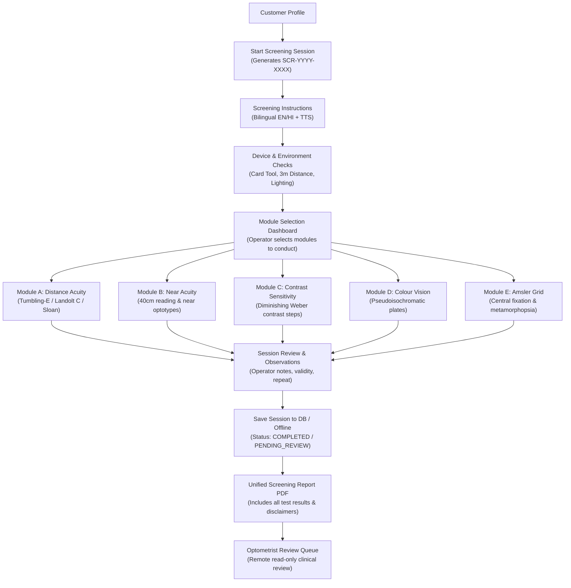

# VisionBridge — Milestone 4 Implementation Plan
## Comprehensive, Modular Preliminary Vision-Screening Suite

> **Product**: VisionBridge  
> **Tagline**: *Speak. We listen. An eye-care professional reviews.*  
> **Milestone**: 4 — Vision Screening Engine (Modular Visual Acuity, Near Vision, Contrast Sensitivity, Colour Vision & Amsler Grid)  
> **Author**: Senior Full-Stack Software Architect, UI/UX Designer & AI Engineer  
> **Date**: February 2026  
> **Status**: APPROVED & IN PROGRESS  

---

## 1. Executive Summary & Philosophy

Milestones 1–3 established the VisionBridge foundation:
- Secure JWT authentication with role-based access (`STORE_OPERATOR`, `OPTOMETRIST`, `ADMIN`).
- Store center multi-tenancy with strict store isolation.
- Customer registration, demographic profiling, and informed consent.
- Multilingual voice-first interview engine with deterministic adaptive branching and red-flag symptom interception.
- IndexedDB offline local storage (Dexie.js) and dual MongoDB Atlas / in-memory demo persistence.

**Milestone 4** elevates VisionBridge from a single-symbol optotype checker into a **structured, modular visual-function preliminary screening suite**. Rather than presenting an arbitrary eye-test game, it implements validated clinical screening principles from peer-reviewed ophthalmological literature while strictly maintaining non-diagnostic medical boundaries.

---

## 2. Research & Clinical References

The implementation is designed with reference to peer-reviewed literature on mobile visual-function assessment:

1. **Bano T, Wolffsohn JS, Sheppard AL (2024)**  
   *Assessment of visual function using mobile Apps.* Eye (Nature).  
   *Key Takeaway*: Highlights device-specific display characteristics, non-uniform sub-pixel arrangements, lack of standardized luminance across consumer screens, and the critical importance of explicitly identifying tests as preliminary/uncalibrated unless physical calibration is verified.

2. **Bastawrous A, Rono HK, Livingstone IAT, et al. (2015)**  
   *Development and Validation of a Smartphone-Based Visual Acuity Test (Peek Acuity) for Clinical Practice and Community-Based Fieldwork.* JAMA Ophthalmology.  
   *Key Takeaway*: Demonstrated that a 4-orientation Tumbling E staircase procedure on smartphones can achieve reliable acuity screening in low-resource rural settings. Key operational requirements: monocular testing, strict eye-occlusion guidance, random orientation sequences to prevent memorization, and remote record sharing for optometrist review.

3. **Near Visual Acuity Measurements by Community Screeners (2025)**  
   *Digital (Peek) Testing Versus Conventional Charts in India.* PMC12369907.  
   *Key Takeaway*: Demonstrates feasibility of community health workers administering digital near-vision tests at a controlled 40 cm distance using optotypes and reading paragraphs with explicit distance confirmation.

4. **Goh C, et al. (2025)**  
   *Mobile Apps and Visual Function Assessment: A Comprehensive Review of the Latest Advancements.* PMC11724824.  
   *Key Takeaway*: Synthesizes current evidence across contrast sensitivity, pseudoisochromatic colour vision, Amsler grids, and visual fields. Highlights that consumer screens lack calibrated colour gamuts and that visual field testing on handheld screens without gaze fixation monitoring is unreliable and should be avoided or deferred.

---

## 3. Existing Architecture & Reusable Components

The existing VisionBridge codebase provides a solid foundation:
- **Backend**: Express + TypeScript + Node.js with `authenticateToken` middleware, store isolation enforcement, and audit logging (`AuditLog.ts`).
- **Database**: Mongoose models with self-healing connection and in-memory mock fallback (`IN_MEMORY_CUSTOMERS`, `IN_MEMORY_INTERVIEWS`, `IN_MEMORY_SCREENINGS`).
- **Client**: React 18, TypeScript, Vite, Tailwind CSS with custom healthcare palette (`navy-950`, `teal-600`, `teal-50`), Lucide React icons.
- **Offline / Local Cache**: IndexedDB via Dexie.js (`VisionBridgeLocalDB` in `client/src/offline/db.ts`).
- **Multilingual TTS**: Web Speech API speech synthesis (`useVoiceInterview.ts`) supporting Hindi and English voice guidance.

---

## 4. Proposed Screening Suite Architecture

Rather than a monolithic single-screen test, Milestone 4 introduces a **shared, modular screening engine** in `client/src/features/screening/`:

```
client/src/features/screening/
├── types/
│   └── screening.ts             # Domain interfaces, stimulus definitions, protocol types
├── components/
│   ├── ScreeningDashboard.tsx   # Module selector & session overview
│   ├── TestInstructions.tsx    # Multilingual (EN/HI) operator & customer guidance + TTS
│   ├── DeviceCalibration.tsx   # Physical card calibration, viewing distance, lighting check
│   ├── EyeSelection.tsx        # OD (Right Eye), OS (Left Eye), OU (Binocular) selector
│   ├── TestProgress.tsx        # Trial counter, level progress, timer
│   ├── TestStimulus.tsx        # Dynamic stimulus renderer (Tumbling E, Landolt C, Sloan, Contrast, Colour plates, Amsler)
│   ├── TestResponse.tsx        # Touch direction keypad, letter grid, numeric keypad, keyboard shortcuts
│   ├── TestResultSummary.tsx   # Per-module outcome card with validity indicators
│   ├── ScreeningSessionSummary.tsx # Unified intake summary before completion
│   └── ScreeningStatusBadge.tsx # Status pill (COMPLETED, SKIPPED, INCONCLUSIVE, UNCALIBRATED)
├── modules/
│   ├── distance-acuity/         # Module A: Distance Visual Acuity (Tumbling E, Landolt C, Sloan, LogMAR)
│   ├── near-acuity/             # Module B: Near Visual Acuity (40 cm reading / near optotypes)
│   ├── contrast-sensitivity/    # Module C: Contrast Sensitivity (Diminishing Weber contrast / Pelli-Robson principle)
│   ├── colour-vision/           # Module D: Colour Vision Assessment (Pseudoisochromatic screening plates)
│   └── amsler-grid/             # Module E: Amsler Grid Assessment (Monocular macular distortion check)
├── hooks/
│   ├── useScreeningSession.ts   # Session state machine (pause, resume, repeat, save)
│   └── useOptotypeCalibration.ts# Physical scaling calculation from device DPI / card tool
├── services/
│   ├── screeningApi.ts          # REST client for /api/screenings endpoints
│   └── acuityCalculator.ts     # LogMAR, Snellen, and passing threshold algorithms
└── utils/
    ├── randomSequence.ts       # Anti-memorization orientation shuffler
    └── svgOptotypes.ts          # Mathematically exact SVG paths (Tumbling E, Landolt C, Sloan)
```

---

## 5. Screening Modules Detailed Specification

### Module A: Distance Visual Acuity (Priority: Very High)
- **Protocol**: `VB-DISTANCE-2026.1`
- **Optotype Options**: Tumbling E (default for universal/non-literate use), Landolt C (broken ring in 4 orientations), and Sloan letters (C, D, H, K, N, O, R, S, V, Z).
- **Presentation**: Monocular OD (Right Eye) $\rightarrow$ Monocular OS (Left Eye) $\rightarrow$ Optional Binocular OU.
- **Occlusion**: Clear instructions to gently cover the fellow eye with palm or occluder without applying pressure.
- **Levels & Progression**: 7 levels matching standard LogMAR / Snellen visual angles (Level 1 = 6/60 down to Level 7 = 6/6). Multi-trial threshold (3–4 presentations per level, 75% passing criterion to advance).
- **Anti-memorization**: Random sequence generated per level; strictly caps identical consecutive orientations at 2.
- **Output**: LogMAR-style score + approximate Snellen equivalent (e.g., LogMAR 0.18 / Snellen 6/9 equivalent at 3.0 m).
- **Calibration Status**: Explicitly labeled `PRELIMINARY_UNCALIBRATED` unless verified with physical card calibration.

### Module B: Near Visual Acuity (Priority: Very High)
- **Protocol**: `VB-NEAR-2026.1`
- **Testing Distance**: Standard 40 cm (16 inches) confirmed by operator.
- **Optotypes / Reading Text**: Controlled Tumbling E / Landolt C sized for 40 cm visual angle, accompanied by Hindi and English near-reading paragraphs for literate customers.
- **Levels**: Sized for N-point equivalents: N5 (~6/6 near equiv), N6 (~6/9 near equiv), N8 (~6/12 near equiv), N10 (~6/18 near equiv), N12 (~6/24 near equiv), N18 (~6/36 near equiv), N36 (~6/60 near equiv).
- **Eyes Tested**: OD, OS, and Binocular (OU) with customer wearing reading spectacles if normally worn.
- **Output**: Near visual acuity grade (e.g. N6 at 40 cm) + repeat option if lighting or distance was disrupted.

### Module C: Contrast Sensitivity (Priority: High)
- **Protocol**: `VB-CONTRAST-2026.1 (Prototype Framework)`
- **Principle**: Pelli-Robson and Mars contrast sensitivity principles. Presents fixed large optotype (equivalent to 6/60 size at test distance) with diminishing Weber contrast levels.
- **Contrast Sequence**: 8 discrete contrast steps: 100% (LogCS 0.00), 50% (LogCS 0.30), 25% (LogCS 0.60), 12.5% (LogCS 0.90), 6.25% (LogCS 1.20), 3.12% (LogCS 1.50), 1.56% (LogCS 1.80), 0.78% (LogCS 2.10).
- **Interface**: 4-orientation direction buttons or 4-choice optotype selector.
- **Caveat & Prototype Notice**: High-visibility disclaimer noting that uncalibrated consumer screen backlight and ambient lighting affect luminance contrast. Module is explicitly designated as a **non-proprietary screening prototype**.

### Module D: Colour Vision Assessment (Priority: High, Non-Infringing)
- **Protocol**: `VB-COLOUR-2026.1 (Pseudoisochromatic Demonstration Prototype)`
- **Licensing & Copyright Compliance**: **Zero copyrighted Ishihara images**. Uses procedurally generated, legally compliant pseudoisochromatic dot matrix plates with controlled isoluminant colour coordinates:
  - Plate 1: Demonstration Control Plate (High luminance contrast numeral '12' or circle, visible to all observers).
  - Plate 2: Red-Green Protan/Deutan Screening Plate (Red/Orange dots on Green/Olive background forming numeral '8' or '3').
  - Plate 3: Red-Green Vanishing / Diagnostic Plate (Numeral visible only to trichromatic normal colour vision).
  - Plate 4: Tritan Blue-Yellow Screening Plate.
- **Answer Input**: Large numeric touch keypad (0–9) + "Nothing Visible" button.
- **Limitations Banner**: Explicit notice that screen sRGB gamuts, night mode, screen protectors, and room lighting impact colour accuracy. Designed as a non-diagnostic screener.

### Module E: Amsler Grid Assessment (Priority: Medium)
- **Protocol**: `VB-AMSLER-2026.1`
- **Display**: High-contrast 20×20 grid with central fixation dot.
- **Monocular Assessment**: Tested OD, then OS, with reading spectacles on if worn.
- **Sector Localization**: Records presence and quadrant of distortion:
  - `NO_DISTORTION` (Normal: all lines perceived straight and continuous)
  - `WAVY_LINES` (Metamorphopsia — wavy, bent, or distorted lines)
  - `MISSING_AREAS` (Scotoma — blind spots, dark holes, or missing grid areas)
  - `BLURRED_AREAS` (Localized blurring)
  - `OTHER` / `UNABLE_TO_COMPLETE`
- **Emergency Alert**: Acute metamorphopsia or sudden curtain-like dark areas immediately trigger the Red-Flag Guidance Banner advising prompt ophthalmologist evaluation.

---

## 6. Overall Screening Session Workflow



---

## 7. Database Schema & Backend Changes

### ScreeningSession Document Model (`server/src/models/Screening.ts`)
To support modular multi-test sessions while preserving backwards compatibility:

```typescript
export interface IScreeningSession extends Document {
  screeningId: string;           // e.g. "SCR-2026-0101"
  customerId: string;
  customerCode?: string;
  customerName?: string;
  storeId: string;
  storeName?: string;
  conductedBy: {
    id: string;
    name: string;
  };
  interviewId?: string;
  protocolVersion: string;
  selectedTests: Array<'DISTANCE_ACUITY' | 'NEAR_ACUITY' | 'CONTRAST_SENSITIVITY' | 'COLOUR_VISION' | 'AMSLER_GRID'>;
  completedTests: string[];
  skippedTests: string[];
  inconclusiveTests: string[];
  calibrationDetails: {
    deviceType: 'MOBILE' | 'TABLET' | 'DESKTOP';
    viewportWidth: number;
    viewportHeight: number;
    devicePixelRatio: number;
    calibrationStatus: 'CALIBRATED_PHYSICAL' | 'APPROXIMATE_ESTIMATE' | 'UNCALIBRATED';
    pixelsPerMm?: number;
    configuredDistanceMeters: number;
    confirmedDistanceMeters: number;
    ambientLighting: 'CONFIRMED_ADEQUATE' | 'DIM' | 'EXCESSIVE_GLARE';
  };
  // Individual Modular Test Results
  distanceAcuity?: {
    optotypeType: 'TUMBLING_E' | 'LANDOLT_C' | 'SLOAN';
    rightEye: IEyeAcuityResult;
    leftEye: IEyeAcuityResult;
    binocular?: IEyeAcuityResult;
    testQuality: 'GOOD' | 'FAIR' | 'UNRELIABLE';
    validityStatus: 'VALID_CALIBRATED' | 'PRELIMINARY_UNCALIBRATED' | 'INVALID_CONDITIONS' | 'INCONCLUSIVE';
    notes?: string;
  };
  nearAcuity?: {
    distanceCm: number;
    rightEye: INearAcuityResult;
    leftEye: INearAcuityResult;
    binocular?: INearAcuityResult;
    validityStatus: string;
    notes?: string;
  };
  contrastSensitivity?: {
    protocol: string;
    scoreLogCs: number;
    lowestContrastPercent: number;
    trials: any[];
    validityStatus: string;
    notes?: string;
  };
  colourVision?: {
    protocol: string;
    platesTested: number;
    platesCorrect: number;
    observedClassification: 'NORMAL_TRICHROMATIC' | 'POSSIBLE_RED_GREEN_DEFICIENCY' | 'INCONCLUSIVE';
    validityStatus: string;
    notes?: string;
  };
  amslerGrid?: {
    performed: boolean;
    rightEye: IAmslerEyeResult;
    leftEye: IAmslerEyeResult;
    observations?: string;
  };
  // Summary & Review
  operatorObservations?: string;
  warningFlags: string[];
  hasRedFlags: boolean;
  overallValidity: 'VALID_CALIBRATED' | 'PRELIMINARY_UNCALIBRATED' | 'INVALID_CONDITIONS' | 'INCONCLUSIVE';
  status: 'IN_PROGRESS' | 'COMPLETED' | 'INCOMPLETE' | 'ABORTED';
  professionalReviewStatus: 'PENDING_REVIEW' | 'UNDER_REVIEW' | 'REVIEWED';
  professionalReview?: {
    reviewerId: string;
    reviewerName: string;
    reviewTimestamp: Date;
    clinicalNotes: string;
    decision: 'ROUTINE_OBSERVATION' | 'REFERRAL_RECOMMENDED' | 'RETEST_REQUESTED';
    urgency: 'ROUTINE' | 'PRIORITY' | 'IMMEDIATE';
  };
  disclaimer: string;
  startedAt: Date;
  completedAt?: Date;
  createdAt: Date;
  updatedAt: Date;
}
```

### API Endpoints (`/api/screenings`)
- `POST /api/screenings/start`: Initialize new session with `selectedTests`.
- `GET /api/screenings/:id`: Retrieve complete screening session with individual test results.
- `GET /api/screenings/customer/:customerId`: Retrieve customer screening session history.
- `PUT /api/screenings/:id/progress`: Save in-progress individual test results incrementally.
- `POST /api/screenings/:id/complete`: Calculate scores, validate test completeness, flag asymmetries and anomalies, attach disclaimer, update customer workflow status.
- `GET /api/screenings`: List sessions with store isolation and pagination.
- `GET /api/screenings/:id/pdf`: Executive HTML/PDF printable report.
- `POST /api/screenings/:id/review`: Optometrist clinical review sign-off endpoint.

---

## 8. Offline Behaviour & State Preservation

- **IndexedDB Sync Table**: Extends Dexie schema to store full modular session objects.
- **Local State Survival**: When an operator conducts a test and the browser tab refreshes or loses connectivity, `useScreeningSession` automatically resumes from the local state.
- **Idempotent Sync**: Screening records carry unique `clientUuid` and `screeningId` to prevent duplicate writes during network reconnection.

---

## 9. Professional Review Workflow & Governance

1. **Strictly Read-Only for Operators**: Store operators conduct and record tests; they cannot sign off clinical decisions.
2. **Optometrist Clinical Triage**:
   - Optometrists log in and inspect the customer's full intake record (interview answers + all completed screening modules + calibration conditions).
   - Can inspect OD vs OS visual acuity, near reading speed/acuity, contrast sensitivity thresholds, colour vision plate responses, and Amsler sector distortion notes.
   - Can record clinical notes, select action (`ROUTINE_OBSERVATION`, `REFERRAL_RECOMMENDED`, or `RETEST_REQUESTED`), and sign off.

---

## 10. Medical Disclaimers & Safety Safeguards

1. **Mandatory Disclaimer**:
   > *"This is a preliminary visual-function screening record. It is not a diagnosis, spectacle prescription, or substitute for a comprehensive eye examination. Results require interpretation by a qualified eye-care professional."*
2. **No Dioptric Power Prediction**: The system never outputs spherical, cylindrical, or axis values.
3. **Emergency Interception**: Reported sudden visual drop, severe eye pain, flashes of light, or acute macular veil prompt an immediate emergency alert banner.

---

## 11. Testing & Verification Strategy

1. **Unit & Protocol Tests**:
   - Stimulus orientation shuffler anti-memorization constraint (no $>2$ consecutive repeats).
   - Acuity staircase / 75% threshold calculation across Levels 1–7.
   - Contrast sensitivity LogCS calculation.
   - Colour vision plate response scoring.
   - Amsler distortion flag detection.
2. **Integration & API Tests**:
   - Session creation, progress saving, and completion endpoints.
   - Store isolation enforcement (operator from Store A cannot access Store B).
   - Optometrist review sign-off.
   - PDF report rendering.
3. **End-to-End Workflow Verification**:
   - Customer profile $\rightarrow$ Start Screening $\rightarrow$ Calibrate $\rightarrow$ Execute 5 Modules $\rightarrow$ Review $\rightarrow$ Complete $\rightarrow$ Optometrist Review $\rightarrow$ PDF Report.

---

## 12. Future Extensibility (Roadmap Design Only)

The database schema and modular engine are structured to accommodate future modules without redesigning the platform:
- `modules/visual-fields/` (when clinical hardware perimeter attachment is available)
- `modules/stereoacuity/` (for depth perception testing with polarized/anaglyph overlays)
- `modules/image-capture/` (front-camera guided anterior segment / external eye capture)
- Dedicated Python + FastAPI microservice for AI image quality analysis (to be evaluated under specialist supervision in a future milestone).

---
*End of Milestone 4 Implementation Plan. Proceeding with Implementation.*

