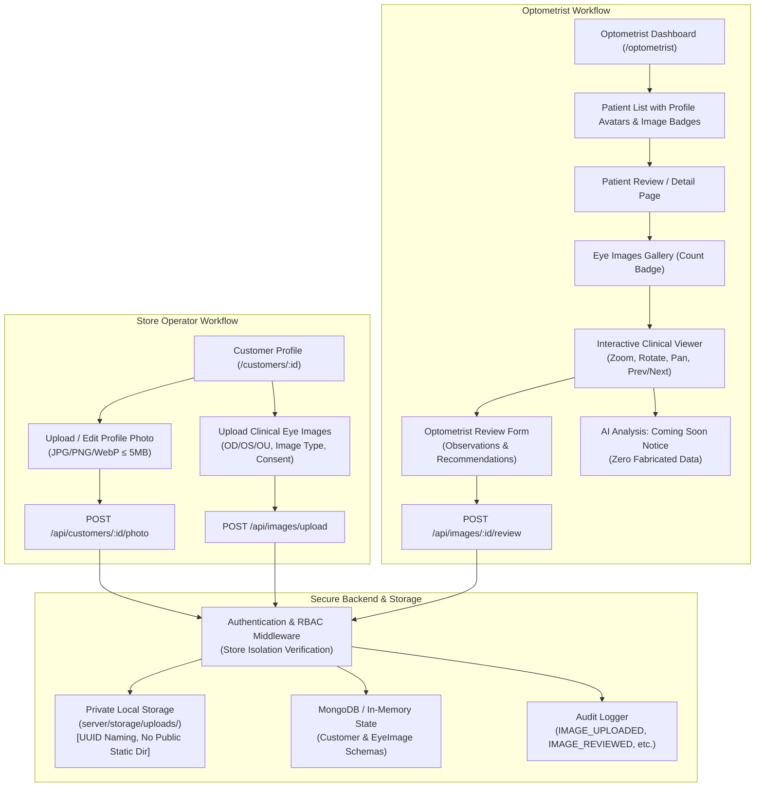

# VisionBridge: Milestone 4.1 Implementation Plan
## Patient Profile Images, Clinical Eye Image Upload & Optometrist Image Review

**Author:** VisionBridge Software Architecture & Clinical Engineering  
**Date:** February 2026  
**Status:** Approved for Implementation  
**Target Milestone:** 4.1  

---

## 1. Executive Summary & Objective

Milestone 4.1 adds a clinical and demographic photographic management subsystem to VisionBridge:
1. **Patient Profile Photo (Feature A):** Personal customer avatar (non-clinical) with circular display, upload, replace, remove, and default avatar fallback. Synchronized across customer profile, store directory, and optometrist dashboards.
2. **Clinical Eye Image Upload (Feature B):** Dedicated "Eye Images & Clinical Photos" section for uploading external eye photographs, gaze-direction photos, anterior segment photos, or fundus images. Captures eye side (OD, OS, OU), image type, capture date, description, clinical context, and mandatory consent verification.
3. **Optometrist Eye Image Viewer (Feature C):** Integrated gallery and full-featured interactive clinical viewer supporting full-screen display, zoom in/out, fit-to-screen, rotation, previous/next navigation, metadata inspection, and authorized downloads.
4. **Optometrist Image Review Notes (Feature D):** Dedicated professional observation and recommendation recording for individual clinical images, linked to the patient record.
5. **AI Analysis Placeholder & Future Architecture (Feature E):** Clearly labeled "AI Analysis — Coming Soon" action explaining that no compatible AI model is currently active, without generating fake results. Accompanied by a future architecture roadmap in `docs/future-ai-image-analysis-architecture.md`.
6. **Secure Storage & RBAC (Feature F & G):** Private local filesystem storage (`server/storage/uploads/`) with authenticated streaming endpoints (`/api/customers/:id/photo` and `/api/images/:id/file`), enforcing store isolation and role-based access.

---

## 2. Architecture & Data Flow



---

## 3. Database Schema Extensions

### 3.1 Customer Schema Extension (`Customer.ts`)
```typescript
export interface ICustomerProfilePhoto {
  storagePath: string;
  url: string; // Authenticated streaming endpoint e.g. /api/customers/:id/photo
  mimeType: string;
  fileSizeBytes: number;
  uploadedAt: Date;
}

// Added to ICustomer:
profilePhoto?: ICustomerProfilePhoto;
```

### 3.2 Clinical Eye Image Schema (`server/src/models/EyeImage.ts`)
```typescript
export type EyeSide = 'RIGHT' | 'LEFT' | 'BOTH' | 'NOT_SPECIFIED';
export type ClinicalImageType = 
  | 'EXTERNAL_PHOTO' 
  | 'GAZE_DIRECTION' 
  | 'ANTERIOR_SEGMENT_SLIT_LAMP' 
  | 'FUNDUS_RETINAL' 
  | 'OTHER';

export type GazeDirection = 
  | 'PRIMARY' 
  | 'UP' 
  | 'DOWN' 
  | 'LEFT' 
  | 'RIGHT' 
  | 'UP_RIGHT' 
  | 'UP_LEFT' 
  | 'DOWN_RIGHT' 
  | 'DOWN_LEFT';

export interface IEyeImageReview {
  reviewId: string;
  reviewedBy: {
    id: string;
    name: string;
    role: string;
    licenseNumber?: string;
  };
  reviewedAt: Date;
  observations: string;
  recommendations: string[];
  status: 'NORMAL' | 'SUSPECTED_PATHOLOGY' | 'INCONCLUSIVE' | 'POOR_IMAGE_QUALITY';
}

export interface IEyeImage extends Document {
  imageId: string; // Unique e.g. IMG-20260208-1001
  customerId: string; // References Customer.customerId
  customerCode: string;
  storeId: string; // For store isolation
  uploadedBy: {
    id: string;
    name: string;
    role: string;
  };
  imageStoragePath: string; // Private path on disk
  thumbnailStoragePath?: string;
  imageType: ClinicalImageType;
  eyeSide: EyeSide;
  gazeDirection?: GazeDirection;
  description?: string;
  clinicalContext?: string;
  captureDate: Date;
  uploadedAt: Date;
  consentRecorded: {
    hasConsent: boolean;
    consentText: string;
    consentedBy: string;
    timestamp: Date;
  };
  mimeType: string;
  fileSizeBytes: number;
  dimensions?: { width: number; height: number };
  reviewStatus: 'PENDING_REVIEW' | 'REVIEWED' | 'REFERRAL_REQUIRED';
  reviews: IEyeImageReview[];
  isArchived: boolean;
}
```

---

## 4. API Endpoints Specification

| Method | Endpoint | Allowed Roles | Description |
| :--- | :--- | :--- | :--- |
| `POST` | `/api/customers/:id/photo` | `STORE_OPERATOR`, `ADMIN` | Upload / replace personal profile picture (max 5MB) |
| `GET` | `/api/customers/:id/photo` | Authenticated | Stream customer profile photo with private headers |
| `DELETE` | `/api/customers/:id/photo` | `STORE_OPERATOR`, `ADMIN` | Remove customer profile picture |
| `POST` | `/api/images/upload` | `STORE_OPERATOR`, `ADMIN` | Upload clinical eye image with metadata and consent (max 15MB) |
| `GET` | `/api/images/customer/:customerId` | Authenticated | List all eye images metadata for a customer |
| `GET` | `/api/images/:id` | Authenticated | Get metadata for a specific eye image |
| `GET` | `/api/images/:id/file` | Authenticated | Securely stream high-resolution original eye image |
| `POST` | `/api/images/:id/review` | `OPTOMETRIST`, `ADMIN` | Submit optometrist clinical observations and recommendations |
| `DELETE` | `/api/images/:id` | `STORE_OPERATOR` (own store), `ADMIN` | Soft-delete / remove clinical image |

---

## 5. Security & Privacy Safeguards

1. **Private Local Storage:** Images are written to `server/storage/uploads/profiles/` and `server/storage/uploads/eye-images/` with UUID-based filenames. The `storage` directory is NEVER served statically via `express.static`.
2. **Authenticated Streaming:** Every image request passes through `authenticateToken` and a store/role authorization check before piping file bytes with appropriate `Content-Type`.
3. **Store Isolation:** Store operators can ONLY access image records and files belonging to their assigned `storeId`. Cross-store requests return `403 FORBIDDEN`.
4. **Mandatory Patient Consent:** The clinical image upload form requires an explicit consent confirmation checkbox: *"Customer has provided informed consent for ocular photographic capture and professional tele-optometry review."*
5. **Audit Logging:** Every upload, view, delete, and review event is recorded in the `AuditLog` collection.

---

## 6. Implementation Roadmap

- [x] Step 1: Create Implementation Plan (`docs/milestone-4.1-implementation-plan.md`).
- [ ] Step 2: Implement storage utility (`server/src/utils/fileStorage.ts`) and create storage directories.
- [ ] Step 3: Implement `EyeImage` model (`server/src/models/EyeImage.ts`) and update `Customer.ts`.
- [ ] Step 4: Implement image controller (`server/src/controllers/imageController.ts`) and customer photo endpoints.
- [ ] Step 5: Implement image routes (`server/src/routes/imageRoutes.ts`) and mount in `app.ts`.
- [ ] Step 6: Create client imaging types, services, and components:
  - `ProfilePhotoUploader.tsx`
  - `ClinicalEyeImageUploader.tsx`
  - `EyeImageGallery.tsx`
  - `ImageViewerModal.tsx`
- [ ] Step 7: Update `CustomerProfilePage.tsx` with profile photo and Eye Images section.
- [ ] Step 8: Update `OptometristDashboard.tsx` with profile avatars, eye image count badge, and "Review Eye Images" action.
- [ ] Step 9: Update screening PDF report to include an eye images summary appendix.
- [ ] Step 10: Create Future AI Image Analysis Architecture document (`docs/future-ai-image-analysis-architecture.md`).
- [ ] Step 11: Write automated test suite `server/test-milestone4.1-images.js` and run verification.
- [ ] Step 12: End-to-end verification and compile Testing Report (`docs/milestone-4.1-testing-report.md`).

