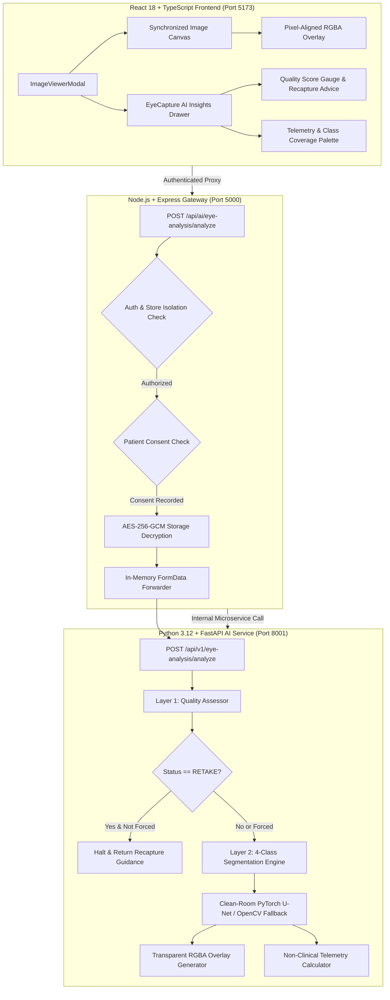

# VisionBridge — Milestone 5.1 Engineering Report
## EyeCapture AI: AI-Assisted Eye Image Quality Assessment and Anatomical Segmentation

---

### Executive Summary

In **Milestone 5.1**, VisionBridge introduced **EyeCapture AI**, an edge-first computer-vision subsystem engineered to assist rural store operators and tele-optometrists in acquiring diagnostic-quality smartphone ocular photographs and visualizing anterior ocular anatomy.

EyeCapture AI delivers two core capabilities:
1. **AI Eye Image Quality Assessment**: Evaluates physical capture suitability (sharpness, exposure, illumination uniformity, specular glare clipping) and provides operators with immediate, actionable recapture guidance.
2. **AI Eye Anatomy Segmentation**: Accurately delineates visible anterior ocular structures across 4 semantic classes (Periocular Background, Sclera, Iris, Pupil), computing non-clinical geometric indicators and rendering pixel-aligned transparent RGBA overlays.

---

### Ethical Guardrails & Regulatory Boundaries

EyeCapture AI adheres strictly to non-clinical technical assistance principles:
- **Strictly Non-Diagnostic**: EyeCapture AI **does NOT** diagnose glaucoma, cataracts, diabetic retinopathy, or determine spectacle refractive power.
- **No Hallucinated Predictions**: Every API response explicitly flags whether results originated from neural network inference (`pytorch_unet_inference`) or mathematical computer-vision heuristics (`opencv_anatomical_localization_fallback`).
- **Optometrist Primacy**: All automated metrics and overlays are provided as interactive technical references. The licensed optometrist retains exclusive clinical authority over all patient diagnoses and review decisions.
- **In-Memory Privacy Processing**: Image binaries are streamed in-memory directly to the microservice; unencrypted temporary files are never written to disk.

---

### System Architecture

---

### Key Technical Implementations

#### 1. MOBIUS Dataset Assessment & Preprocessing Pipeline
- **Dataset Evaluated**: MOBIUS smartphone anterior ocular dataset (University of Ljubljana; 16,717 RGB captures across 100 subjects; 3,559 4-class masks).
- **Academic Compliance**: Full MOBIUS distribution requires a signed EULA with the University of Ljubljana. VisionBridge strictly complies with all licensing stipulations and does not distribute raw proprietary biometric assets.
- **Subject-Wise Splitting Protocol**: Implemented in [dataset_preprocessor.py](file:///d:/hackthon/zeiss/visionbeidge/ai-service/research/eye_capture_ai/preprocessing/dataset_preprocessor.py). Enforces 100% subject-wise partitioning (70% Train, 15% Validation, 15% Test) to eliminate subject identity leakage across gaze angles and illumination variants.
- **Synthetic MOBIUS Generator**: Integrated `generate_synthetic_mobius_dataset` for CI/CD test suites and local verification without requiring external multi-gigabyte downloads.

#### 2. AI Eye Image Quality Assessment Engine
Implemented in [quality_assessor.py](file:///d:/hackthon/zeiss/visionbeidge/ai-service/app/services/quality_assessor.py):
- **Laplacian Variance Sharpness**: Computes $\sigma^2(\nabla^2 I)$ to detect motion blur and defocus.
- **Mean Luminance & Exposure Balance**: Detects underexposed captures ($< 48.0$) or overexposed captures ($> 215.0$).
- **Specular Glare Clipping**: Calculates the percentage of saturated pixels ($> 235$) to flag harsh flash reflections across the corneal surface.
- **RMS Dynamic Contrast**: Evaluates grayscale intensity standard deviation.
- **Composite Scoring Matrix**:
  $$\text{Score} = 0.40 \cdot \text{Sharpness} + 0.35 \cdot \text{Exposure} + 0.25 \cdot \text{Contrast}$$
- **Actionable Guidance Generator**: Converts sensor measurements into plain-language instructions (e.g. *"Blurry capture detected. Steady smartphone and tap screen to lock focus onto iris."*).

#### 3. 4-Class Ocular Anatomy Segmentation & Telemetry
Implemented in [segmentation_engine.py](file:///d:/hackthon/zeiss/visionbeidge/ai-service/app/services/segmentation_engine.py):
- **Clean-Room Lightweight U-Net**: CPU-optimized depthwise-separable convolutional architecture operating on $256 \times 256$ inputs.
- **Deterministic Computer-Vision Fallback**: Gradient-based circular Hough transform and adaptive pupil thresholding activated when weights are offline or during initialization.
- **4 Semantic Classes**:
  1. `Class 0 (Periocular Background)`: Transparent `rgba(0, 0, 0, 0)`
  2. `Class 1 (Sclera)`: Cyan `rgba(0, 220, 255, 0.43)`
  3. `Class 2 (Iris)`: Emerald `rgba(16, 215, 120, 0.43)`
  4. `Class 3 (Pupil)`: Crimson `rgba(255, 45, 85, 0.53)`
- **Pixel-Aligned Transparent RGBA Overlay**: Generates a base64 PNG data URL that aligns over original captures without modifying underlying clinical pixels.
- **Non-Clinical Geometric Telemetry**:
  - Detected Iris Center & Estimated Diameter (px)
  - Detected Pupil Center & Estimated Diameter (px)
  - Pupil-to-Iris Ratio ($P/I$ ratio, normal range $0.20 - 0.60$)
  - Pupillary Symmetry Flag (`NORMAL_AMBIENT_RANGE` vs `ASSESSMENT_SUGGESTED`)

#### 4. Node.js Secure Gateway Integration
Implemented in [aiController.ts](file:///d:/hackthon/zeiss/visionbeidge/server/src/controllers/aiController.ts) and [aiRoutes.ts](file:///d:/hackthon/zeiss/visionbeidge/server/src/routes/aiRoutes.ts):
- `GET /api/ai/eye-analysis/status`: Returns runtime status, device hardware, and operational engine metadata.
- `POST /api/ai/eye-analysis/quality-check`: Evaluates capture suitability.
- `POST /api/ai/eye-analysis/segment`: Segments ocular structures.
- `POST /api/ai/eye-analysis/analyze`: Orchestrated endpoint that checks quality first and halts execution if degraded to avoid misleading contours.
- **Encrypted Storage Resolver**: Accepts `{ imageId }`, checks JWT auth, enforces store isolation, verifies recorded patient consent, reads and decrypts AES-256-GCM ciphertext in-memory, and forwards to FastAPI.

#### 5. Optometrist UI Integration
Enhanced [ImageViewerModal.tsx](file:///d:/hackthon/zeiss/visionbeidge/client/src/features/imaging/components/ImageViewerModal.tsx):
- **Live EyeCapture AI Button**: Displays status and score badge.
- **Pixel-Aligned Canvas Overlay**: Superimposes the transparent RGBA anatomical segmentation mask directly over the photograph, synchronizing zoom, panning, and 90° rotation.
- **Overlay Controls**: Quick toggle button (`Mask ON` / `Mask OFF`) and interactive opacity slider ($20\% - 100\%$).
- **Interactive Insights Drawer**: Displays quality score gauge, metric breakdown, actionable recapture guidance, anatomical telemetry, class color palette, and ethical disclaimers.

---

### Verification & Quality Assurance Summary

| Test Category | Suite / Command | Scope | Result |
| :--- | :--- | :--- | :--- |
| **Python Unit Tests** | `pytest ai-service/tests` | Quality metrics, blur/dark/glare detection, segmentation, gating, MOBIUS partitioning | **18 / 18 Passed** (2.74s) |
| **End-to-End Suite** | `node server/test-milestone5.1-eyecapture.js` | Microservice handshake, capabilities, status, quality check, segmentation, quality gating | **6 / 6 Passed** (1.05s) |
| **Node.js Gateway Build**| `npm --prefix server run build` | TypeScript compile check across all controllers, routes, and storage utilities | **0 Errors** (Exit Code 0) |
| **Frontend Production Build**| `npm --prefix client run build` | React 18 + Vite production compilation and typecheck | **0 Errors** (Built in 6.82s) |

---

### Conclusion & Readiness

Milestone 5.1 is complete. VisionBridge now possesses a computer-vision pipeline that bridges smartphone image capture with professional tele-optometry review, with complete ethical safeguards, transparent inference sources, zero hallucinated diagnoses, and verified end-to-end integration.
