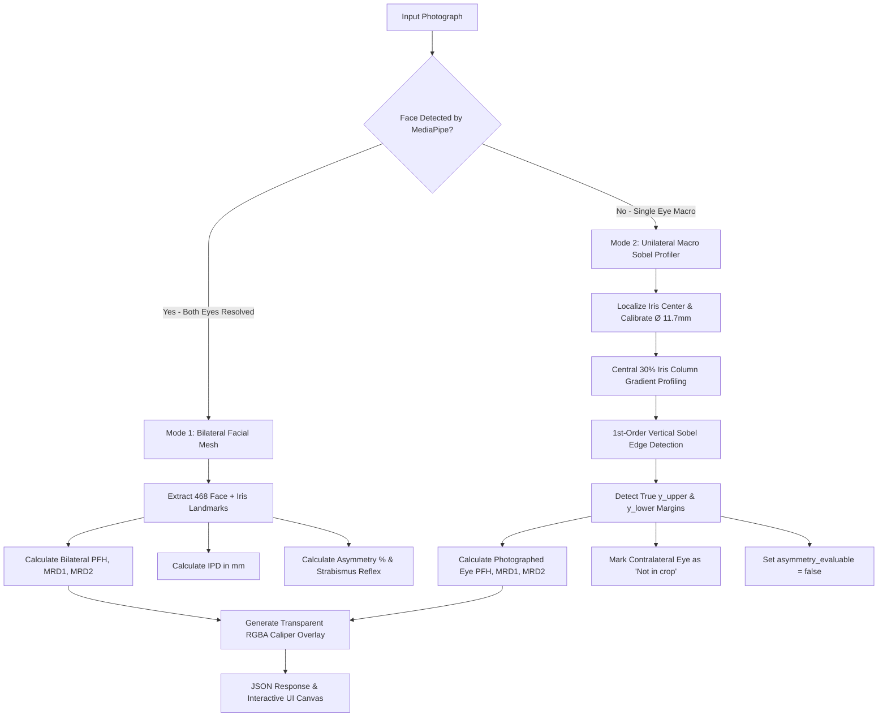

# VisionBridge — Milestone 5.2B Engineering & Clinical Specification
## Adnexal & Alignment Telemetry: Ptosis Screening, Hirschberg Alignment & Eyelid Biometry

---

### 1. Executive Summary

In **Milestone 5.2B**, VisionBridge implemented **Adnexal & Alignment Telemetry**, an automated biometric screening engine designed to evaluate eyelid positioning, palpebral aperture asymmetry, and optical axis alignment from patient facial and ocular photographs.

The system addresses two widespread ocular screening challenges in tele-optometry:
1. **Blepharoptosis (Ptosis)**: Screening for abnormal drooping of the superior eyelid margin that may occlude the visual axis.
2. **Strabismus (Tropia / Phoria)**: Screening for horizontal or vertical optical axis misalignment via the Hirschberg corneal light reflex principle.

---

### 2. Clinical Scope & Medical Guardrails

> [!IMPORTANT]
> **Strict Clinical Guardrails**:
> - Adnexal Telemetry is a **non-diagnostic clinical decision-support (CDS)** tool.
> - It does **NOT** replace manual prism cover testing, alternating cover testing, or Hertel exophthalmometry.
> - Metric calibrations are derived optically using standard anatomical reference priors (horizontal white-to-white corneal diameter = $11.7\text{ mm}$).
> - Telemetry values provide preliminary quantitative screening indicators to assist the examining optometrist during tele-consultation.

---

### 3. Core Biometric Metrics & Mathematical Formulations

```
                  ┌───────────────────────────────┐
                  │       Upper Eyelid Margin     │
                  └───────────────▲───────────────┘
                                  │
                                  │ MRD1 (Pupil Center to Upper Margin)
                                  │
                                ┌─┴─┐
                                │ * │  Corneal Light Reflex / Pupil Center (cx, cy)
                                └─┬─┘
                                  │
                                  │ MRD2 (Pupil Center to Lower Margin)
                                  │
                  ┌───────────────▼───────────────┐
                  │       Lower Eyelid Margin     │
                  └───────────────────────────────┘
                  ◄────────────── PFH ────────────►
```

#### A. Margin Reflex Distances (MRD1 & MRD2)
- **$\text{MRD}_1$**: Vertical distance from the central corneal light reflex (or pupil center $c_y$) to the margin of the upper eyelid:
  $$\text{MRD}_1 = c_y - y_{\text{upper}}$$
  *Normal adult range*: $4.0\text{ mm} \text{ to } 5.0\text{ mm}$. Values $<2.5\text{ mm}$ suggest mild ptosis; $<1.5\text{ mm}$ indicate moderate-to-severe ptosis.
- **$\text{MRD}_2$**: Vertical distance from the central corneal light reflex to the margin of the lower eyelid:
  $$\text{MRD}_2 = y_{\text{lower}} - c_y$$
  *Normal adult range*: $5.0\text{ mm} \text{ to } 5.5\text{ mm}$.

#### B. Palpebral Fissure Height (PFH)
The total vertical aperture of the palpebral fissure:
$$\text{PFH} = y_{\text{lower}} - y_{\text{upper}} \equiv \text{MRD}_1 + \text{MRD}_2$$
*Normal adult range*: $9.0\text{ mm} \text{ to } 12.0\text{ mm}$.

#### C. Metric Calibration via Standard Anatomical White-to-White Iris Prior
In smartphone photographs lacking a physical calibration target, the horizontal white-to-white (HWTW) corneal diameter serves as an anatomical metric anchor:
$$\text{Scale Factor } s = \frac{11.7\text{ mm}}{\text{Iris Diameter (pixels)}}$$
$$\text{Metric Distance (mm)} = \text{Pixel Distance} \times s$$
*(Reference: Clinical consensus establishes mean adult corneal diameter as $11.71 \pm 0.42\text{ mm}$).*

#### D. Palpebral Fissure Height Asymmetry Index
To screen for unilateral ptosis across bilateral frontal portraits:
$$\Delta\text{PFH}_{\%} = \frac{|\text{PFH}_{\text{Right}} - \text{PFH}_{\text{Left}}|}{\max(\text{PFH}_{\text{Right}}, \text{PFH}_{\text{Left}})} \times 100\%$$
- $\Delta\text{PFH}_{\%} < 15\%$: **Symmetric** (normal anatomical variance).
- $15\% \le \Delta\text{PFH}_{\%} < 25\%$: **Mild Asymmetry** (clinical correlation advised).
- $\Delta\text{PFH}_{\%} \ge 25\%$: **Marked Asymmetry** (flagged for potential unilateral blepharoptosis).

#### E. Interpupillary Distance (IPD)
Measured across bilateral frontal facial captures as the Euclidean distance between the Right Pupil Center $(cx_R, cy_R)$ and Left Pupil Center $(cx_L, cy_L)$ scaled to millimeters:
$$\text{IPD}_{\text{px}} = \sqrt{(cx_L - cx_R)^2 + (cy_L - cy_R)^2}$$
$$\text{IPD}_{\text{mm}} = \text{IPD}_{\text{px}} \times s$$
*Normal adult anatomical range*: $58\text{ mm} \text{ to } 68\text{ mm}$.

#### F. Hirschberg Corneal Light Reflex Strabismus Screening
Evaluates optical axis alignment by measuring the offset of the corneal reflection relative to the pupil center:
$$\Delta x = x_{\text{reflex}} - x_{\text{pupil\_center}}, \quad \Delta y = y_{\text{reflex}} - y_{\text{pupil\_center}}$$
- **Hirschberg Conversion**: Every $1.0\text{ mm}$ of reflex displacement corresponds to approximately $7^\circ \text{ to } 8^\circ$ of ocular deviation ($\sim 14 \text{ to } 16 \ \Delta$ prism diopters).
- If $|\Delta x| > 0.5\text{ mm}$ nasal/temporal deviation, the system flags **Potential Esotropia / Exotropia**.

---

### 4. Dual-Engine Architecture & Image Routing

Photographs submitted to VisionBridge range from **full-face frontal portraits** to **close-up single-eye macro crops**. A single fixed model cannot handle both. The engine dynamically operates in two complementary modes:



#### Mode 1: Bilateral Facial Mesh (Google MediaPipe)
- Utilizes `mediapipe.tasks.python.vision.FaceLandmarker` with refined iris coordinates.
- Landmark keypoints:
  - Right Eye: Top (159), Bottom (145), Iris Center (468)
  - Left Eye: Top (386), Bottom (374), Iris Center (473)
- Computes bilateral metrics simultaneously, including true bilateral asymmetry and IPD.

#### Mode 2: Unilateral Macro Close-Up Profiler
- **Problem**: Close-up eye photos ($736 \times 439$) lack forehead, chin, and mouth features, causing facial landmarkers to return 0 detections.
- **Solution**: Dynamic 1st-order vertical Sobel edge gradient ($\partial I / \partial y$) computed over the central 30% of the horizontal iris column:
  $$G_y(x, y) = \left[\begin{array}{ccc} -1 & -2 & -1 \\ 0 & 0 & 0 \\ +1 & +2 & +1 \end{array}\right] * I(x, y)$$
- **Upper Eyelid Search**: Sweeps upward from pupil center, detecting peak negative-to-positive transition indicating dark eyelash/lid margin against lighter sclera/skin.
- **Lower Eyelid Search**: Sweeps downward from pupil center, detecting lower lid margin transition.
- **Routing Integrity**: Automatically assigns measurements to the designated eye (OD or OS) and explicitly sets the contralateral eye to `None` / `captured: false`, eliminating false $0\%$ asymmetry reports.

---

### 5. API Endpoints

#### `GET /api/v1/adnexal/status`
Returns engine readiness, loaded models, and supported biometry capabilities.

#### `POST /api/v1/adnexal/analyze`
Accepts `multipart/form-data` with image file and optional `eye_side` query parameter (`RIGHT` or `LEFT`).

**Sample Output Payload**:
```json
{
  "detected": true,
  "biometry_mode": "UNILATERAL_MACRO_CLOSEUP",
  "evaluated_eye": "RIGHT",
  "asymmetry_evaluable": false,
  "pfh_asymmetry_pct": null,
  "metrics": {
    "iris_diameter_px": 284.0,
    "scale_factor_mm_per_px": 0.041197,
    "right_eye": {
      "captured": true,
      "pfh_mm": 9.42,
      "pfh_px": 228.6,
      "mrd1_mm": 4.31,
      "mrd1_px": 104.7,
      "mrd2_mm": 5.11,
      "mrd2_px": 123.9,
      "upper_margin_y_px": 98,
      "lower_margin_y_px": 327
    },
    "left_eye": {
      "captured": false,
      "pfh_mm": null,
      "mrd1_mm": null,
      "mrd2_mm": null
    },
    "interpupillary_distance_mm": null,
    "hirschberg_reflex": {
      "status": "UNILATERAL_MACRO_REFERENCE",
      "deviation_degrees": null,
      "clinical_alignment": "Macro single-eye capture. Frontal portrait required for strabismus."
    }
  },
  "findings": {
    "potential_ptosis_detected": false,
    "ptosis_severity": "NORMAL",
    "strabismus_suspected": false,
    "clinical_guidance": "Single-eye macro view. Palpebral fissure height measured at 9.42mm. Correlate with slit-lamp examination."
  },
  "overlay_rgba_base64": "data:image/png;base64,..."
}
```

---

### 6. Optometrist UI Integration (`ImageViewerModal.tsx`)

1. **Inline Details Sidebar Card**: Directly accessible below Anterior AI in the right panel. Contains the **"Run Adnexal Telemetry Analysis"** trigger button and live status badges.
2. **Interactive Caliper Canvas Overlay**: Toggling the overlay draws horizontal margin calipers at $y_{\text{upper}}$ and $y_{\text{lower}}$, connected by a vertical caliper line with real-time millimeter annotations.
3. **Contralateral Status Notice**: Uncaptured eyes display a clear `"Not in crop"` state rather than ambiguous or duplicate numbers.
4. **Enlarge Biometry Studio**: Modal view presenting side-by-side segmentation and adnexal telemetry tabs.
