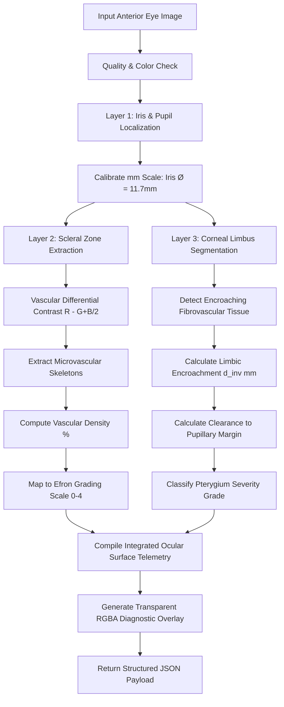

# VisionBridge — Milestone 5.3 Engineering & Clinical Specification
## Conjunctival Hyperaemia (Efron Scale Redness Grading) & Pterygium Encroachment Screening

---

### 1. Executive Summary

In **Milestone 5.3**, VisionBridge introduces **Ocular Surface & Hyperaemia Telemetry**, an objective computer-vision screening engine for evaluating anterior eye photographs. It delivers two capabilities:

1. **Conjunctival Hyperaemia Scorer**: Quantifies bulbar conjunctival microvascular coverage and maps it to the internationally standardized **Efron Grading Scale (0 to 4)**.
2. **Pterygium Encroachment Screener**: Detects fibrovascular tissue extending across the corneal limbus into the clear corneal stroma, quantifying horizontal invasion distance in millimeters and measuring clearance to the pupillary visual axis.

---

### 2. Clinical Context & Medical Guardrails

> [!IMPORTANT]
> **Regulatory & Clinical Decision Support Notice**:
> - This engine provides **technical decision-support measurements** to assist tele-optometrists during remote review.
> - It does **NOT** diagnose bacterial conjunctivitis, anterior uveitis, episcleritis, or determine surgical candidacy for pterygium excision.
> - Redness and lesion measurements are preliminary quantitative proxies. The examining optometrist or ophthalmologist retains sole clinical responsibility for patient diagnosis, slit-lamp biomicroscopy, and treatment planning.

---

### 3. Anatomical & Mathematical Formulations

```
               Bulbar Conjunctiva / Sclera (Vessel Network)
                      │
                      ▼             Corneal Limbus Boundary
                   ░░░░░░             │
                   ░ █ ░░             │
         Nasal     ░███░░─────────────┼──────┐  Clear Cornea
         Pterygium ░█████► Encroachment│      │
         Tissue    ░███░░   Distance  │  (•) ◄── Pupil Margin
                   ░ █ ░░    (d mm)   │      │
                   ░░░░░░             │      │
                                      └──────┘
```

#### A. Conjunctival Hyperaemia & Scleral Vascular Density
The bulbar conjunctiva covers the anterior sclera and possesses a dense microvascular bed that dilates in response to inflammation, dry eye, infection, or contact lens irritation.

1. **Scleral Zone Isolation**:
   The engine extracts the scleral mask $M_{\text{sclera}}$ using the anterior segmentation engine (or adaptive white-sclera chrominance filtering in macro crops).
   $$\text{Area}_{\text{sclera}} = \sum_{(x,y)} M_{\text{sclera}}(x, y)$$
   *(Requires $\text{Area}_{\text{sclera}} \ge 500\text{ pixels}$ for valid evaluation).*

2. **Red-Green Vascular Differential Contrast**:
   Because blood vessels are rich in hemoglobin (which absorbs green and blue light strongly while reflecting red), vascular differential contrast is computed as:
   $$C_{\text{vascular}}(x, y) = R(x, y) - \frac{G(x, y) + B(x, y)}{2}$$

3. **Vascular Extraction via Adaptive Local Gradient & Percentile Thresholding**:
   Within the scleral mask, high-contrast vascular pixels are isolated:
   $$V(x, y) = \begin{cases} 1 & \text{if } C_{\text{vascular}}(x, y) > P_{75}(C_{\text{sclera}}) \text{ and } \nabla I(x, y) > \theta_{\text{edge}} \\ 0 & \text{otherwise} \end{cases}$$

4. **Scleral Vascular Density Percentage ($VD_{\%}$)**:
   $$VD_{\%} = \frac{\sum_{(x, y) \in M_{\text{sclera}}} V(x, y)}{\text{Area}_{\text{sclera}}} \times 100\%$$

#### B. International Efron Grading Scale (0 to 4) Mapping
Vascular density is mapped to the standard clinical 5-tier Efron Grading Scale:

| Efron Grade | Severity Category | Vascular Density ($VD_{\%}$) | Clinical Tele-Guidance |
|:---:|:---|:---:|:---|
| **0** | **Normal / Trace** | $< 6.0\%$ | Clear, uninflamed conjunctiva. Routine observation. |
| **1** | **Mild Hyperaemia** | $6.0\% - 12.9\%$ | Mild injection; consistent with ocular surface dryness, fatigue, or mild allergic irritation. |
| **2** | **Moderate Hyperaemia** | $13.0\% - 21.9\%$ | Moderate diffuse injection; evaluate for blepharitis, meibomian gland dysfunction, or allergic conjunctivitis. |
| **3** | **Severe Hyperaemia** | $22.0\% - 31.9\%$ | Marked injection / ciliary flush; prioritize slit-lamp exam with fluorescein staining to rule out acute anterior uveitis or corneal ulcer. |
| **4** | **Extreme / Severe** | $\ge 32.0\%$ | Intense hyperaemia / perilimbal engorgement; urgent ophthalmology triage indicated. |

---

#### C. Pterygium & Corneal Encroachment Biometry

A **pterygium** is an elastotic, fibrovascular subepithelial growth that originates in the bulbar conjunctiva (most commonly nasal) and advances horizontally past the limbus onto the clear cornea.

1. **Limbus Delineation**:
   The iris center $(c_x, c_y)$ and radius $R_{\text{iris}}$ define the circular limbic boundary:
   $$\mathcal{L} = \left\{ (x, y) \mid \sqrt{(x - c_x)^2 + (y - c_y)^2} = R_{\text{iris}} \right\}$$

2. **Corneal Metric Scaling Factor**:
   Calibrated using the standard adult horizontal white-to-white iris diameter ($11.7\text{ mm}$):
   $$s = \frac{11.7\text{ mm}}{2 \times R_{\text{iris}} \text{ (pixels)}}$$

3. **Intra-Corneal Encroachment Region**:
   Fibrovascular tissue detected inside the corneal disc ($\sqrt{(x-c_x)^2 + (y-c_y)^2} < R_{\text{iris}}$):
   - **Apex Coordinate**: The advancing apex $(x_{\text{apex}}, y_{\text{apex}})$ closest to the pupil center.
   - **Invasion Distance**: Horizontal distance from the limbic boundary to the apex:
     $$d_{\text{inv\_px}} = R_{\text{iris}} - |x_{\text{apex}} - c_x|$$
     $$d_{\text{inv\_mm}} = d_{\text{inv\_px}} \times s$$
   - **Pupillary Margin Clearance**:
     $$d_{\text{pupil\_clearance\_mm}} = (|x_{\text{apex}} - c_x| - R_{\text{pupil}}) \times s$$

4. **Triage Classification**:
   - **No Encroachment**: $d_{\text{inv\_mm}} \le 0.2\text{ mm}$ (clear cornea / pinguecula confined to sclera).
   - **Grade I (Mild)**: $0.2\text{ mm} < d_{\text{inv\_mm}} \le 1.5\text{ mm}$ (limbal encroachment; monitored for progression).
   - **Grade II (Moderate)**: $1.5\text{ mm} < d_{\text{inv\_mm}} \le 3.0\text{ mm}$ (approaching pupil; induces astigmatism).
   - **Grade III (Advanced)**: $d_{\text{inv\_mm}} > 3.0\text{ mm}$ or $d_{\text{pupil\_clearance\_mm}} < 1.0\text{ mm}$ (threatens visual axis; surgical consultation advised).

---

### 4. Engine Architecture & Multi-Layer Pipeline



---

### 5. API Endpoints

- **`GET /api/v1/hyperaemia/status`**: Returns module readiness, version, supported clinical scales, and metric descriptions.
- **`POST /api/v1/hyperaemia/analyze`**: Accepts `multipart/form-data` with eye photograph. Returns Efron grade, vascular density %, pterygium measurements, clinical triage advice, and RGBA overlay.
