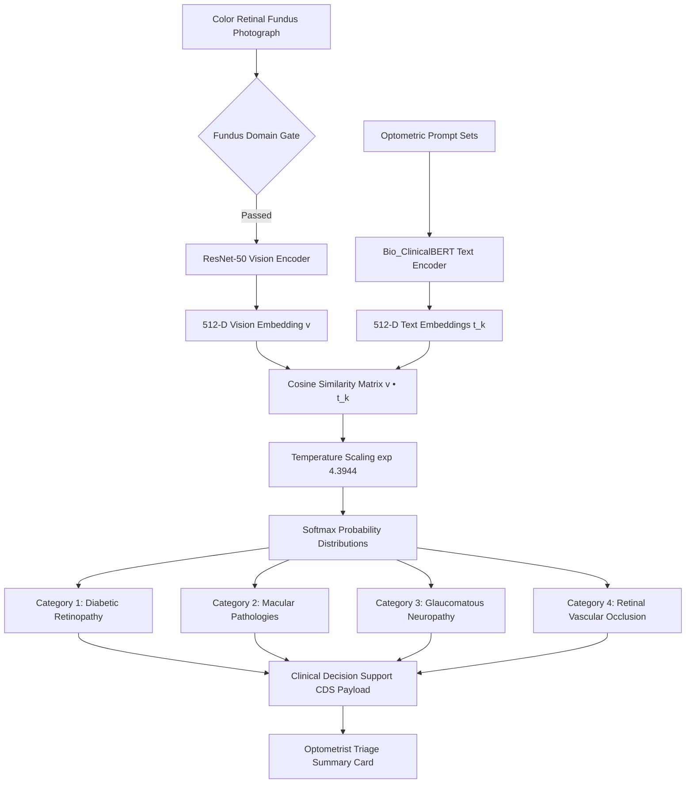

# VisionBridge — Milestone 5.4 Engineering & Clinical Specification
## Production Retinal Foundation AI (FLAIR): Real-Time Zero-Shot Inference & Fundus Telemetry

---

### 1. Executive Summary

In **Milestone 5.4**, VisionBridge advances the FLAIR proof of concept (established in Milestone 5.2A) into the production **Python AI Microservice (`ai-service/app/services/retinal_engine.py`)**.

This milestone equips tele-optometrists with zero-shot retinal foundation model inference running directly on CPU. It enables automated clinical decision support for **Color Retinal Fundus Photography (CFP)** across four major sight-threatening ophthalmic disease categories:
1. **Diabetic Retinopathy (DR)**: Normal vs Mild, Moderate, Severe NPDR, and Proliferative DR.
2. **Macular Pathologies**: Diabetic Macular Edema (DME), Full-Thickness Macular Hole, AMD with Drusen, and Epiretinal Membrane.
3. **Glaucomatous Optic Neuropathy**: Normal optic disc vs Pathological cup enlargement.
4. **Retinal Vascular Occlusion**: Branch/Central Retinal Vein and Artery Occlusion.

---

### 2. Clinical Scope & Non-Diagnostic Guardrails

> [!IMPORTANT]
> **Regulatory Decision-Support Boundary**:
> - FLAIR operates as a **preliminary technical decision-support and feature-retrieval engine**.
> - It does **NOT** autonomously establish a definitive medical diagnosis of diabetic retinopathy, glaucoma, or macular holes.
> - It does **NOT** determine spectacle prescription power.
> - All reported percentages represent mathematical softmax probabilities derived from text-image cosine similarities in a 512-dimensional shared latent space.
> - A licensed optometrist or ophthalmologist retains sole clinical authority for interpreting fundus images, performing dilated slit-lamp biomicroscopy, and ordering confirmatory optical coherence tomography (OCT) or fluorescein angiography (FA).

---

### 3. Model Architecture & Pretrained Foundation

| Parameter | Value |
|---|---|
| **Model** | FLAIR (*Foundation Language-Image Model of the Retina*) |
| **Checkpoints** | Hugging Face: `jusiro2/FLAIR` (Apache 2.0 license) |
| **Architecture** | Contrastive Vision-Language Dual-Encoder |
| **Vision Backbone** | ResNet-50 ($23.51\text{M}$ parameters) with 512-D linear projection |
| **Text Backbone** | `emilyalsentzer/Bio_ClinicalBERT` ($109.75\text{M}$ parameters) with 512-D projection |
| **Total Parameters** | **133,259,521** (~133.26M) |
| **Latent Space** | L2-normalized unit hypersphere $\mathbb{S}^{511} \subset \mathbb{R}^{512}$ |
| **Learned Scale $\tau$** | $\text{logit\_scale} = 4.3944$ ($\exp(4.3944) \approx 80.999$) |
| **Execution Platform** | Native multithreaded CPU inference via PyTorch 2.15.0+cpu |
| **Input Dimensions** | Color Fundus Photograph (CFP) resized to $512 \times 512 \times 3$ RGB |

---

### 4. Domain Gating & Modality Validation

As established in Milestone 5.2A, foundation vision-language models must never be executed on out-of-domain images (e.g. selfies, external eye crops, anterior slit-lamp photos).

The production engine enforces a multi-point **Fundus Modality Pre-Flight Gate**:

1. **Circular Field-of-View (FOV) Verification**:
   Fundus cameras utilize circular telecentric optics producing a dark or black circular perimeter:
   $$\text{Perimeter Dark Fraction } \phi_{\text{perimeter}} = \frac{\sum_{(x,y) \in \partial \text{Border}} \mathbb{I}[I(x,y) < 30]}{|\partial \text{Border}|}$$
   A true CFP exhibits $\phi_{\text{perimeter}} > 0.45$.

2. **Retinal Chromatic Signature**:
   Human fundus reflectance is dominated by the choroidal melanin and retinal vascular bed, yielding intense red reflectance with deep blue absorbance:
   $$\text{Fundus Red-to-Blue Ratio } \mathcal{R}_{\text{fundus}} = \frac{\text{Mean}(R)}{\text{Mean}(B) + 1e-5} > 2.2$$

3. **Gating Response**:
   If an input photo fails the fundus domain gate, the engine halts before running the 133M parameter neural net and returns:
   ```json
   {
     "is_fundus_image": false,
     "error": "DOMAIN_MISMATCH: Input image does not exhibit color retinal fundus characteristics. Retinal AI is restricted to fundus photographs."
   }
   ```

---

### 5. Multi-Category Clinical Prompt Hierarchy

FLAIR evaluates fundus images against curated optometric candidate prompt sets:



#### Category 1: Diabetic Retinopathy (DR Staging)
- `"normal retinal fundus without diabetic retinopathy"`
- `"mild non-proliferative diabetic retinopathy with microaneurysms"`
- `"moderate non-proliferative diabetic retinopathy with retinal hemorrhages and hard exudates"`
- `"severe non-proliferative diabetic retinopathy with cotton wool spots"`
- `"proliferative diabetic retinopathy with neovascularization"`

#### Category 2: Macular Integrity (DME / AMD / Hole)
- `"healthy macula with sharp foveal reflex"`
- `"diabetic macular edema with lipid exudates"`
- `"full-thickness macular hole with round foveal defect"`
- `"age-related macular degeneration with confluent drusen"`
- `"epiretinal membrane with retinal surface wrinkling"`

#### Category 3: Glaucoma Optic Neuropathy
- `"normal optic nerve disc and healthy neuroretinal rim"`
- `"glaucomatous optic neuropathy with marked optic cup enlargement"`

#### Category 4: Vascular Occlusion
- `"normal retinal vascular arcade"`
- `"retinal vein occlusion with widespread flame hemorrhages"`
- `"retinal artery occlusion with cherry red spot"`

---

### 6. Production API Endpoints

- **`GET /api/v1/retinal/status`**: Returns engine readiness, loaded checkpoints, parameter counts, and supported diagnostic disease categories.
- **`POST /api/v1/retinal/analyze`**: Accepts `multipart/form-data` with fundus image. Evaluates zero-shot probabilities across all four disease categories, flags referable conditions, calculates urgency triage, and generates visual overlay.
