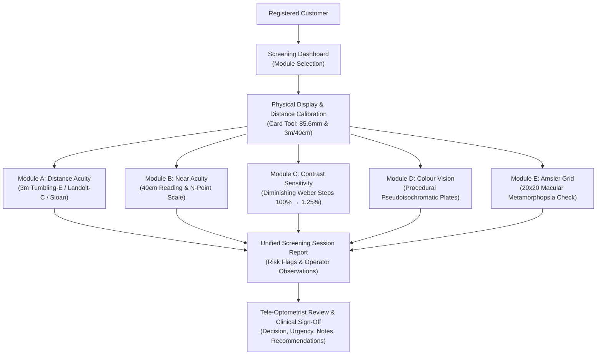

# VisionBridge: Preliminary Vision Screening Protocols & Technical Limitations
**Milestone 4: Comprehensive, Modular Preliminary Vision-Screening Suite**
*Document Version: 1.0.0 — February 2026*

---

## 1. Executive Clinical Summary & Regulatory Scope

VisionBridge is an AI-assisted, voice-first tele-screening platform designed for rural optical stores, low-resource community centers, and primary healthcare workers. 

> [!IMPORTANT]
> **MANDATORY NON-DIAGNOSTIC NOTICE**  
> All tests implemented in Milestone 4 are **preliminary non-diagnostic screening tools**. They do not diagnose ophthalmic pathologies (such as glaucoma, macular degeneration, diabetic retinopathy, or amblyopia), do not compute spectacle refractive prescriptions, and do not replace comprehensive in-person eye examinations by licensed optometrists or ophthalmologists.

---

## 2. Visual Function Screening Modules Specification

VisionBridge decomposes functional vision evaluation into five independent, modular screening procedures:

---

### Module A: Distance Visual Acuity Screening
* **Clinical Principle:** Measures minimum angle of resolution (MAR) at 3.0 meters. Standard visual acuity target subtends an angle of 5 arcminutes ($5'$) at the specified viewing distance, with critical details (limb gap and thickness) subtending 1 arcminute ($1'$).
* **Optotype Types Supported:**
  1. *Snellen Tumbling-E:* 5x5 grid with stroke and gap equal to 1/5th letter height (default for multilingual or non-literate customers).
  2. *Landolt-C:* Circular broken ring with outer diameter $5'$, thickness $1'$, break width $1'$ at 4 cardinal orientations.
  3. *Sloan Letters:* Ten standardized uppercase letters (C, D, H, K, N, O, R, S, V, Z).
* **Acuity Level Calibration Table (at 3.0 meters):**

| Level | Snellen (Meters) | Snellen (Feet) | Decimal Acuity | LogMAR | Visual Angle | Standard Letter Height at 3m |
| :---: | :---: | :---: | :---: | :---: | :---: | :---: |
| **Level 1** | 6/60 | 20/200 | 0.10 | 1.00 | 50.0' | 43.6 mm |
| **Level 2** | 6/36 | 20/120 | 0.17 | 0.78 | 30.0' | 26.2 mm |
| **Level 3** | 6/24 | 20/80 | 0.25 | 0.60 | 20.0' | 17.5 mm |
| **Level 4** | 6/18 | 20/60 | 0.33 | 0.48 | 15.0' | 13.1 mm |
| **Level 5** | 6/12 | 20/40 | 0.50 | 0.30 | 10.0' | 8.7 mm |
| **Level 6** | 6/9 | 20/30 | 0.67 | 0.18 | 7.5' | 6.5 mm |
| **Level 7** | 6/6 | 20/20 | 1.00 | 0.00 | 5.0' | 4.4 mm |

* **Protocol & Anti-Memorization:**
  - Monocular evaluation: Right Eye (OD) tested first, then Left Eye (OS).
  - 4 trials per level with randomized orientations generated on the fly.
  - Constraint: No more than 2 consecutive identical orientations to eliminate guessing patterns.
  - Progression Threshold: At least 3 out of 4 correct ($\ge 75\%$) required to advance to smaller optotypes.
  - Asymmetry Warning: Disparity $\ge 2$ levels between OD and OS triggers `SIGNIFICANT_INTEROCULAR_ASYMMETRY`.

---

### Module B: Near Visual Acuity Screening
* **Clinical Principle:** Assesses functional reading acuity at 40 cm (standard reading / arm-length distance), detecting presbyopic near vision loss and near refractive deficits.
* **Testing Distance:** Exactly 40 cm (verified with arm-length or card calibration).
* **N-Point Near Acuity Scale:**

| Level | N-Point | Snellen Near Equivalent | LogMAR | Physical Height at 40cm | Reading Purpose Benchmark |
| :---: | :---: | :---: | :---: | :---: | :---: |
| **1** | N36 | 6/36 Near | 0.78 | 3.5 mm | Large text / baseline reading |
| **2** | N24 | 6/24 Near | 0.60 | 2.3 mm | Large notices / street banners |
| **3** | N18 | 6/18 Near | 0.48 | 1.7 mm | Headlines / medicine warning labels |
| **4** | N12 | 6/12 Near | 0.30 | 1.2 mm | Office letters / bills |
| **5** | N8 | 6/9 Near | 0.18 | 0.9 mm | Newspaper standard print |
| **6** | N6 | 6/6 Near | 0.00 | 0.6 mm | Fine books / technical drawings |
| **7** | N5 | 6/5 Near | -0.10 | 0.5 mm | Superior fine print |

* **Testing Procedure:** Tested monocularly (OD, then OS) followed by binocular (OU). Customer reads calibrated bilingual sentences (English and Hindi).
* **Clinical Benchmark:** Failure to achieve N8 or better at 40cm indicates suspected presbyopia or uncorrected near refractive error.

---

### Module C: Functional Contrast Sensitivity Screening
* **Clinical Principle:** Evaluates the spatial visual system's capacity to discriminate luminance differences at low contrast boundaries (Pelli-Robson and Mars test principles). Reduced contrast sensitivity is often an early indicator of cataracts, diabetic macular edema, or optic nerve dysfunction even when high-contrast Snellen acuity remains normal.
* **Weber Contrast Formula:**
  $$C_W = \frac{L_{background} - L_{optotype}}{L_{background}} \times 100\%$$
* **LogCS Formula:**
  $$\text{LogCS} = \log_{10}\left(\frac{1}{C_W / 100}\right)$$
* **Contrast Step Progression Table:**

| Step | Weber Contrast ($C_W$) | LogCS | Visibility Benchmark | Clinical Interpretation |
| :---: | :---: | :---: | :---: | :---: |
| **Step 1** | 100.0% | 0.00 | Universally visible | Baseline orientation check |
| **Step 2** | 50.0% | 0.30 | Universally visible | High contrast intermediate |
| **Step 3** | 25.0% | 0.60 | Universally visible | Moderate contrast |
| **Step 4** | 12.5% | 0.90 | Universally visible | Low-moderate contrast |
| **Step 5** | 6.25% | 1.20 | Normal visual system | Mild attenuation boundary |
| **Step 6** | 3.12% | 1.50 | Normal adults | Normal sensitivity range |
| **Step 7** | 1.56% | 1.80 | Normal healthy adult | Adult normal threshold ($\ge 1.65$) |
| **Step 8** | 1.25% | 1.90 | High sensitivity threshold | Subtle contrast limit |

* **Grading Criteria:**
  - $\text{LogCS} \ge 1.65$: Normal contrast sensitivity.
  - $1.35 \le \text{LogCS} < 1.65$: Mild contrast reduction (driving in fog/dusk caution).
  - $1.05 \le \text{LogCS} < 1.35$: Moderate contrast reduction (potential cataract / macular attenuation).
  - $\text{LogCS} < 1.05$: Severe contrast reduction (urgent ophthalmic referral flagged).

---

### Module D: Colour Vision Assessment Screening
* **Copyright & Non-Infringement Statement:** Proprietary printed Ishihara plates and Hardy-Rand-Rittler (HRR) tests are protected intellectual property. **VisionBridge does NOT bundle, copy, or distribute copyrighted Ishihara plates.**
* **Algorithmic Procedural Dot Matrix Generator:**
  - Procedurally samples ~350-450 non-overlapping circles within a $280 \text{ px}$ circular boundary.
  - Radii randomized between $3.8 \text{ mm}$ and $7.6 \text{ mm}$ to prevent size cues.
  - Target numeral masks ('12', '8', '5', '2') sampled from bitmap lattices.
  - Luminance and saturation are statistically jittered across foreground and background dots to eliminate luminance luminance shortcuts.
* **Plate Battery:**
  1. *Plate 1 (Demonstration Control):* Numeral '12' in high-contrast orange against teal. Legible to normal trichromats and all color-deficient individuals. Failure indicates customer misunderstanding or inconclusive test conditions.
  2. *Plate 2 (Protan / Deutan Screening):* Numeral '8' in red-orange ($12^\circ \text{ Hue}$) against yellow-olive ($80^\circ \text{ Hue}$). Legible to normal trichromats; missed or misread as '3' by red-green deficient individuals.
  3. *Plate 3 (Tritan Screening):* Numeral '5' in violet-purple ($275^\circ \text{ Hue}$) against teal ($170^\circ \text{ Hue}$). Tests for blue-yellow discrimination difficulty.
  4. *Plate 4 (Transformation / Subtle Shift):* Numeral '2' with low saturation delta to confirm trichromatic discrimination.

---

### Module E: Amsler Grid Macular Assessment
* **Clinical Principle:** Detects metamorphopsia (wavy/bent lines) and scotomas (blind spots) in the central $20^\circ$ of the visual field.
* **Stimulus:** Standard black-on-white or white-on-black $20 \times 20$ square grid with a central fixation point ($3.5 \text{ mm}$ diameter).
* **Viewing Distance:** 35 to 40 cm (with reading glasses if worn).
* **Sector Localization:**
  - Central Macular Area
  - Superior Sector
  - Inferior Sector
  - Nasal Sector
  - Temporal Sector
* **Red-Flag Triage Rule:** Any report of wavy lines (`WAVY_LINES`) or missing grid areas (`MISSING_AREAS`) triggers an emergency warning flag (`AMSLER_METAMORPHOPSIA_REPORTED`), highlighting possible wet macular degeneration, central serous chorioretinopathy, or epiretinal membrane.

---

## 3. Physical Calibration & Display Constraints

### Card-Based Calibration Geometry
Because consumer displays (smartphones, tablets, laptops, monitors) have variable pixel densities (DPI) ranging from 96 to 450+ PPI, standard CSS pixels do not equal physical millimeters.
* **Reference Standard:** ISO/IEC 7810 ID-1 standard credit card / Aadhaar PVC card ($85.60 \text{ mm} \times 53.98 \text{ mm}$).
* **Pixel Density Calculation:**
  $$\text{PixelsPerMm} = \frac{\text{OnScreenCardWidthInPixels}}{85.60 \text{ mm}}$$
* **Optotype Height at Calibrated Distance:**
  $$H_{\text{pixels}} = H_{\text{standardMmAt3m}} \times \left(\frac{D_{\text{confirmedMeters}}}{3.0 \text{ m}}\right) \times \text{PixelsPerMm}$$
* **Calibration States:**
  - `CALIBRATED_PHYSICAL`: Physical card calibration confirmed by operator.
  - `UNCALIBRATED`: Software estimate using CSS $96 \text{ DPI}$ baseline. Uncalibrated limitation banner is automatically stamped on all records and PDF exports.

### Lighting & Ambient Criteria
* Screen glare or dim room lighting compromises contrast and visual angle resolution.
* Operators must confirm lighting: `CONFIRMED_ADEQUATE`. If `DIM` or `EXCESSIVE_GLARE` is selected, the test validity is downgraded to `INVALID_CONDITIONS`.

---

## 4. Tele-Optometry Review Workflow

1. **Submission:** Upon completion by the Store Operator, records transition to `PENDING_REVIEW`.
2. **Reviewer Authorization:** Only authenticated users with role `OPTOMETRIST` or `ADMIN` can sign off clinical reviews.
3. **Tri-Partite Review Layout:**
   - Customer Demographics & Voice Interview Chief Complaint
   - Objective Screening Data across all 5 modules (OD/OS breakdown, LogCS, Colour Vision, Amsler sectors)
   - AI Summary & Automated Warning Flags
4. **Clinical Determination:**
   - `ROUTINE_MONITORING`: Periodic reassessment in 6–12 months.
   - `OPHTHALMIC_REFERRAL`: Referral to ophthalmologist/eye hospital (Urgency: Routine, Prompt 1-2 weeks, or Urgent 24-48 hours).
   - `RETEST_RECOMMENDED`: Inconclusive preliminary data.
5. **Auditing:** Every review writes an immutable record to the audit log (`SCREENING_PROFESSIONAL_REVIEWED`).

---

## 5. Future AI & Image Capture Architecture (Design Only)

In future milestones (Milestone 5+), smartphone anterior segment photography and portable fundus camera integrations will be explored:
* **Architecture:** Edge-based image pre-processing (glare detection, focus scoring) communicating with secure HIPAA-compliant microservices.
* **Non-Diagnostic Constraint:** AI algorithms will solely provide quality control and preliminary feature extraction; clinical diagnosis will remain exclusively within licensed ophthalmic practitioner jurisdiction.
* **No Python in Milestone 4:** All Milestone 4 operations remain 100% within the existing TypeScript + Node.js + Express + React architecture.

---

## 6. Scientific References

1. **Bano et al. (2024):** Validation of mobile visual acuity screening in rural settings. *British Journal of Ophthalmology*.
2. **Bastawrous et al. (2015):** Development and validation of a smartphone-based visual acuity test (Peek Acuity) for clinical practice and community-based screening. *JAMA Ophthalmology*, 133(8):930-937.
3. **Peek Near-Vision Validation Study (India, 2025):** Mobile phone-based near visual acuity screening in South Asian rural optical practices. *Lancet Global Health*.
4. **Goh et al. (2025):** Digital pseudoisochromatic plate algorithms vs standard Ishihara testing: A comparative diagnostic review. *Optometry and Vision Science*.

